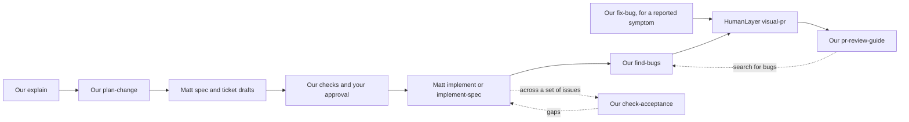

# Using our skills with the originals

Our eight skills establish the evidence, decisions, and review context for a
change. Matt Pocock's originals turn that context into specs, tickets, and
implementation. HumanLayer's originals supply visual explanations and PR
presentations. Start at the skill matching the current task and reuse existing context. These
are task entry points, not a required pipeline.

For a contained change in familiar code, the [light path](light-path.md) uses
the established scope, appropriate implementation checks, and focused review.
Interviews and separate sessions are options when useful or
selected by the project.

## Which skill, in which session

| When | Run | Session | It hands off to |
| --- | --- | --- | --- |
| You are not sure where you are, or which session to use | `whats-next` | Any | The next row, with its command and session |
| A new checkout, or a later skill's tool failed | `setup-tools` | Any; once per checkout | Nothing; later skills read its record |
| You need to know how a flow works before touching it | `explain` | Start the planning session here | `plan-change`, with the note path; HumanLayer's `show-me`, run by you, for a visual recap |
| The ticket is vague, or the change has consequences beyond its own function | `plan-change` | The planning session: start it here when no `explain` ran; keep it open until the tickets exist | Its own spec and ticket drafts, or Matt's `to-spec` and `to-tickets` |
| The plan is agreed and you want the spec and tickets | `plan-change` drafts, or you run `/to-spec` then `/to-tickets` | The same planning session, unbroken: the originals synthesize from the conversation | `implement` or `implement-spec` |
| One ticket is unblocked | `/implement` | A new session per ticket, on the feature branch | `code-review` inside; `find-bugs` and `visual-pr` after |
| Every ticket has its blocking edges and you want the whole spec built | `/implement-spec` | One new session; it runs its own implementer subagents | `check-acceptance` on the integration branch |
| A test fails, an issue reports wrong behavior, or production shows a symptom | `fix-bug` | Where the symptom arrives: the implementing session for a check it broke, a new one for an issue or production symptom | `visual-pr` for the PR; `plan-change` for an open behavior decision |
| The branch is done and the PR is not open yet | `find-bugs`, then `/visual-pr` | The implementing session, or a new one checked out on the branch | The PR |
| You have to review a PR you did not write | `pr-review-guide` | A new session, without the author's context | `find-bugs` inside, when selected |
| You need to know whether the epic, tickets, or spec is delivered | `check-acceptance` | A new session on the delivered head | `plan-change` or `implement` for gaps; `fix-bug` for bugs |
| A contained change in familiar code | The [light path](light-path.md) | The current session | Nothing new |

A new session means a fresh context window: a new session in the host, or
its clear command. Two session rules carry the flow. Keep understanding, planning, spec, and
tickets in one unbroken session: Matt's `to-spec` and `to-tickets` synthesize
from the conversation, and `plan-change` reuses the note and the answers you
gave. Do not clear before the tickets exist; if the session nears the host's
limit, compact at a step boundary. Build and review in fresh sessions: one per
`implement`, one for `implement-spec`, one for `pr-review-guide`, one for
`check-acceptance`. A fresh session reads only what the ticket, spec, tracker,
and repository hold, so decisions and test seams go there, not in chat; Matt's
`handoff`, run before you clear, writes a pointer document for it.

Which interview: an idea with no repository under it takes Matt's `grill-me`.
A change to code takes `plan-change`, which can invoke Matt's `grilling` for
a hard interview and adds what an interview alone cannot: the behavior
comparison through the consumers, the evidence record, preserved behavior,
and the slices. Matt's `grill-with-docs` is the alternative when you want his
flow end to end, with `GLOSSARY.md` and ADRs; run one of the two on a change,
not both. A contained change in familiar code takes neither.

## How to invoke them

After [installation](../README.md#install), our eight skills are registered as
`aantoniadis-skills:<name>`. The examples below use Claude Code's `/` prefix;
use `$` instead in Codex. In OpenCode, run a skill with
`opencode run --command <name>` or the `/skills` menu. Hosts can also select
skills through their normal discovery. Each of our skills except find-bugs,
setup-tools, and whats-next opens with a kickoff round from
[asking](../skills/ASKING.md) for the choices your
prompt leaves open, one recommendation per question; a prompt that states them
skips those questions, "go" takes the recommendations, and a small diff (at most
5 files and 150 changed lines) takes them without a round.

Matt's and HumanLayer's originals are installed through their own routes
([original skills](../README.md#original-skills)) and registered by the host:
`/mattpocock-skills:implement` in Claude Code, `$mattpocock-skills:implement`
in Codex, `/implement` or the `skill` tool in OpenCode; an `npx skills`
install registers each as `/<name>`. Our skills keep each author's choice of
who runs it, as [package references](../skills/REFERENCES.md) say: `grilling`
is invoked through the host; `to-spec`, `to-tickets`, `implement`,
`implement-spec`, `show-me`, and `visual-pr` are user-invoked, so our skill finishes its deliverable and
hands you the command. A call inside an original such as Matt's `/tdd` means
the original installed beside it.

## 1. Prepare the project

**Session:** any; once per checkout, again only to repair a tool.

Package installation provides the local skills; the originals are installed
separately through their own routes. Project setup is optional: use it when useful
preparation or repair would otherwise be repeated. Existing capabilities and
project commands can be used directly.

For reusable preparation, name the work the tools should support:

```text
/aantoniadis-skills:setup-tools I plan to run explain, plan-change, and pr-review-guide here.
```

This discovers tools, prepares useful capabilities, and checks real operations.
It saves a [local tool record](../skills/TOOL-SETUP.md) outside the repository.
Later skills locate it directly; setup leaves project instructions and tracked
files unchanged. [Setup guide](setup-tools.md).

Matt's separate engineering setup writes project conventions and is outside
our local-only tool setup. If you choose that workflow and want those project
edits, invoke it explicitly:

```text
/mattpocock-skills:setup-matt-pocock-skills Configure this project for the original engineering skills, reusing existing agent instructions and tracker conventions.
```

This writes the project's `docs/agents/` guidance for the issue tracker, domain
layout, and applicable triage labels, plus pointers in its agent instructions.
Choose the tracker you actually use; local Markdown tickets are supported.
This setup has a different purpose from `setup-tools`: one records workflow
conventions, the other verifies investigation capabilities.

## 2. Understand the existing behavior

**Session:** start the planning session here and keep it open through step 4.

Use one concrete question that will inform the change:

```text
/aantoniadis-skills:explain How does order confirmation reserve stock and emit events today? Trace a repeated confirmation and a reservation failure. I am preparing a change to make confirmation repeat-safe.
```

The note records the inspected revision, flow, evidence, and unknowns. Give its
actual path to the planning step. For a visual recap, run HumanLayer's original `show-me` afterwards; our skill owns the explanation and optional HTML page.
[How it works](explain.md).

## 3. Agree on the change

**Session:** the same one; `plan-change` reuses the note and your answers.

```text
/aantoniadis-skills:plan-change Plan repeat-safe order confirmation. Reuse our understanding note at <note path>. Decide the repeated-call and concurrent-call behavior, preserve reservation rollback, and agree where we will test it.
```

The skill can invoke Matt's `grilling` for a hard interview while owning the
plan. It records named decisions, changed and preserved behavior, evidence limits,
accepted risks, test seams, and the slices blocked by unresolved choices.
Routine coding choices remain with implementation. [How it works](plan-change.md).

## 4. Draft, review, and publish the spec and tickets

**Session:** the same planning session, unbroken; both routes read the
conversation.

Two routes. Matt's format and tracker publication: when the plan is delivered,
`plan-change` hands you the command, because `to-spec` and `to-tickets` are
user-invoked and synthesize from the conversation so far:

```text
/mattpocock-skills:to-spec Use the plan at <plan path>.
/mattpocock-skills:to-tickets Use the spec at <spec URL or path>.
```

`to-spec` sketches the test seams and checks them with you before it writes;
the plan's agreed seams answer that question. `to-tickets` gives each ticket
its blocking edges, which `implement-spec` reads as a task graph.

Our drafting and review:

```text
/aantoniadis-skills:plan-change Prepare local spec and ticket drafts from <plan path>. Carry each agreed decision, preservation requirement, evidence limit, and feedback instruction into the affected drafts. Check readiness, then show the drafts and proposed statuses for publication approval.
```

`plan-change` drafts from the plan, checks the results, and owns publication
within your approval. Review the proposed slices and blocking edges. An
unresolved behavior choice blocks its dependent work; implementation tests that
are planned but not yet run are recorded as such.

Read the drafts before approving them. Decision identifiers appearing in a
ticket do not prove that its acceptance criteria preserve the decision's
meaning.

After review, the spec becomes authoritative and the plan points to it. Tickets
carry their relevant decisions and acceptance criteria in their own bodies,
with evidence links and a feedback destination. Approve the exact drafts and
statuses you want published to the configured tracker.

Direct use of Matt's `to-spec` or `to-tickets` follows their original publication
workflow and readiness defaults. Use the `plan-change` prompt above when you
want our decision-preservation and draft-review process.

## 5. Implement the tickets

**Session:** a new one per ticket for `implement`, or one new session for
`implement-spec`. Only a build small enough to finish inside the planning
session stays there.

One ticket at a time: start a fresh session with an issue URL or local
ticket path, its supporting spec, and accessible evidence; clear between
tickets. Check out the feature branch first; `implement` commits to the
current branch and does not create one. Replace the placeholders with actual
paths or URLs:

```text
/mattpocock-skills:implement Implement <ticket URL or path> using <spec URL or path>. Follow the named decisions, preserved invariants, agreed test seam, and feedback instructions. Reopen a newly needed behavior decision before affected work. Report the delivered subset and verification actually run.
```

The original `implement` fetches the ticket and states its title, uses TDD
where possible at the agreed seams, runs checks, calls Matt's `code-review`
installed beside it, and commits to the current branch. Work any ticket whose
blockers are complete; the tracker or ticket files carry those blocking
relationships.

The whole spec in one run: after `to-tickets` has written the blocking edges,
start one fresh session and run:

```text
/mattpocock-skills:implement-spec Implement <spec URL or path> and its tickets. Follow the named decisions, preserved invariants, and the test seams named in the spec and tickets. Report the integration branch, the tickets resolved, and the verification actually run.
```

`implement-spec` reads the tickets as a task graph, starts a fresh implementer
subagent per ticket in its own worktree, each driving `tdd`, merges each onto
one integration branch, runs `code-review` once at the end, and resolves the
tickets. It opens a draft PR only when the tracker closes work through PRs or
you ask for one. It needs the tracker that `setup-matt-pocock-skills`
configured and a host that runs subagents in the background with worktrees.
It has no seam step of its own, so `plan-change` carries the agreed seams
into the spec and tickets. Afterwards, `pr-review-guide` reviews the
integration branch and `check-acceptance` checks it against the spec (step 9).

A fresh session cannot read another machine's ignored scratch files. Put
required decisions in the ticket and make supporting evidence available through
the tracker, committed documents, or files present in that session. Matt's
`handoff`, which you run before clearing, writes a handoff document in the
temp directory that points the fresh session at the plan, spec, and tickets.
Feedback returns to the recorded planning destination when implementation
finds a consequential mismatch.

## 6. Fix a reported bug

**Session:** where the symptom arrives: the implementing session for a check
it broke, a new one for an issue or a production symptom.

For a failing test, an issue with steps, or a production symptom:

```text
/aantoniadis-skills:fix-bug tests/test_confirm.py fails with two reservations after one stock timeout. One reservation per confirmed order is the contract. Fix it, HTML, leave the fix in the working tree.
```

The skill pins the contract, reproduces the symptom with one saved command,
finds the cause, lands the fix with a regression test that went red then
green, and widens by evidence to origin, reach, and consequence. The
`diagnosis.md` note and its page carry the runs a reviewer can check. Matt's
`diagnosing-bugs` is the loop-only alternative you run directly.
[How it works](fix-bug.md).

## 7. Check defects and open the PR

**Session:** the implementing session, or a new one checked out on the branch.

For a focused search for bugs before creating the PR:

```text
/aantoniadis-skills:find-bugs Review the current branch against main. Use the ticket's agreed behavior and preservation requirements.
```

This investigates defects; it does not fix them or publish a PR. Request any
fixes separately. It complements the `code-review` that Matt's `implement` and `implement-spec` run.
[How it works](find-bugs.md).

Then request HumanLayer's original PR workflow explicitly:

```text
/visual-pr Create or update the PR for this branch. Use <ticket URL> and <spec URL> as context. Describe the intentional changes actually delivered, their decision references, and the checks actually run. Use links PR readers can access.
```

The original commits pending task changes, pushes the branch, creates the PR
or updates the existing one, and writes the description in its own template
under `.humanlayer/tasks/`. The decision and verification requirements in the
prompt are the task it receives from our planning workflow. When you write the
PR without it, Matt's model-invoked `pr` shapes the body.

## 8. Review the PR

**Session:** a new one; the reviewer's guide should not inherit the author's
context.

```text
/aantoniadis-skills:pr-review-guide <PR URL> I am unfamiliar with this codebase. Explain the main changes, where to start, what to skim, and how the delivered behavior relates to the agreed spec.
```

The bare form `/aantoniadis-skills:pr-review-guide <PR URL>` opens with the kickoff
round: familiarity, HTML or text, full review or overview, search for bugs. The
prompt above answers familiarity, so that question is skipped.

The guide pins head and base, traces the important changes, and can call our
`find-bugs` for a selected search for bugs. If you are reviewing an existing PR, start here;
you do not need to invoke `find-bugs` separately first. The guide explains and
reports; it does not approve, merge, or fix the PR. [How it works](pr-review-guide.md).

## 9. Check delivered work against its requirements

**Session:** a new one on the delivered head.

For a set of issues, an epic, tickets, or a spec, after implementation,
including the integration branch that `implement-spec` leaves:

```text
/aantoniadis-skills:check-acceptance Epic #120 and its sub-issues. Check the feature branch at its current head against main. Confirm the requirement list first; search for bugs.
```

The skill pins the head, splits each source into quoted requirements, traces
the feature code, and reports each requirement as Met, Partial, Unmet, Not
verified, Needs clarification, or Not applicable, with evidence. It also lists
delivered behavior nobody asked for. It does not edit code or give a ship
verdict, and it writes to tickets only when you ask. Gaps go to `plan-change`
or Matt's `implement`, and bugs to `fix-bug`. [How it works](check-acceptance.md).

One possible sequence when all these tasks are requested:



## Artifacts and direct upstream use

| Owner | Artifact convention |
| --- | --- |
| Our investigation and report skills | Recorded `Investigations:` location, else `.scratch/<topic>/`, kept out of commits; HTML is an optional companion |
| Our planning workflow | One authoritative plan/spec, material revision notes, and self-contained tickets at the selected project/tracker locations |
| Matt's original local ticket workflow | One file per ticket under `.scratch/<feature-slug>/issues/`, in dependency order |
| Matt's original `implement-spec` | One integration branch holding every ticket's merged work; a draft PR only when the tracker closes work through PRs or you ask |
| HumanLayer's original `visual-pr` | `.humanlayer/tasks/<task-slug>/pr-description.md` when that task directory exists, otherwise `.humanlayer/tasks/pr-<number>/description.md` |
| Direct original architecture or visual skills | Their own presentation and output conventions; our shared HTML workflow applies to our reports |

Any other installed original runs the same way through the host's
registration. Supply the task and its boundaries;
an original follows its own workflow, not all of ours. For an effort too
large for one planning session, Matt's `wayfinder` maps decision tickets
first and merges at `to-spec`; Matt's `retro`, run after a session, proposes
changes to the agent's environment.

When an original is not installed, the agent names the install command from
[original skills](../skills/setup-tools/references/upstream-skills.md) and
uses an authorized fallback or stops the dependent work. Our planning
workflow drafts locally when you do not take the `to-spec` handoff; a request
for Matt's format still needs its install.

