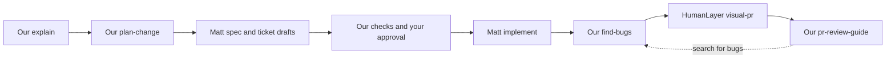

# Using our skills with the originals

Our five skills establish the evidence, decisions, and review context for a
change. Matt Pocock's originals turn that context into specs, tickets, and
implementation. HumanLayer's originals supply visual explanations and PR
presentations. Start at the skill matching the current task and reuse existing context. These
are task entry points, not a required pipeline.

For a contained change in familiar code, the [light path](light-path.md) uses
the established scope, appropriate implementation checks, and focused review.
Interviews and separate sessions are options when useful or
selected by the project.

## How to invoke them

After [installation](../README.md#install), our five skills are registered as
`aantoniadis-skills:<name>`. The examples below use Claude Code's `/` prefix;
use `$` instead in Codex. In OpenCode, run a skill with
`opencode run --command <name>` or the `/skills` menu. Hosts can also select
skills through their normal discovery. Each of our skills opens
with a kickoff round from [asking](../skills/ASKING.md) for the choices your
prompt leaves open, one recommendation per question; a prompt that states them
skips those questions, and "go" takes the recommendations.

Matt's and HumanLayer's originals are installed through their own routes
([original skills](../README.md#original-skills)) and registered by the host:
`/mattpocock-skills:implement` in Claude Code, `$mattpocock-skills:implement`
in Codex, `/implement` or the `skill` tool in OpenCode; an `npx skills`
install registers each as `/<name>`. Our skills keep each author's choice of
who runs it, as [package references](../skills/REFERENCES.md) say: `grilling`
is invoked through the host; `to-spec`, `to-tickets`, `implement`, `show-me`,
and `visual-pr` are user-invoked, so our skill finishes its deliverable and
hands you the command. A call inside an original such as Matt's `/tdd` means
the original installed beside it.

| Work | Skill that owns it | Original sources it uses |
| --- | --- | --- |
| Prepare investigation tools | Our `setup-tools` | None; a sign-in or activation step only a human can do gets short manual instructions |
| Explain current code | Our `explain` | HumanLayer's `show-me`, run by you afterwards, for a visual recap: component trees, file trees, code-shape diffs |
| Decide intended behavior | Our `plan-change` | Optional Matt `grilling`, or the selected original interview/domain mode |
| Draft a spec and tickets from those decisions | Our `plan-change` drafts locally and owns review and publication, or hands you Matt's `to-spec` and `to-tickets` | Matt's originals, run by you, synthesize from the planning conversation and publish under their own workflow |
| Implement an agreed ticket | Matt's `implement` | Matt's `tdd` where possible and `code-review` after implementation |
| Find defects in a change | Our `find-bugs` | Project tools recorded during setup |
| Create or update the PR | HumanLayer's `visual-pr` | Its original description template and visual references |
| Help a human review the PR | Our `pr-review-guide` | Our `find-bugs` for the search for bugs |

## 1. Prepare the project

Package installation provides the local skills; the originals are installed
separately through their own routes. Project setup is optional: use it when useful
preparation or repair would otherwise be repeated. Existing capabilities and
project commands can be used directly.

For reusable preparation, name the work the tools should support:

```text
/aantoniadis-skills:setup-tools I plan to run explain, plan-change, and pr-review-guide here.
```

This discovers tools, prepares useful capabilities, and checks real operations.
It saves a [local tool record](../skills/TOOL-SETUP.md) outside the repository.
Later skills locate it directly; setup leaves project instructions and tracked
files unchanged. [Setup guide](setup-tools.md).

Matt's separate engineering setup writes project conventions and is outside
our local-only tool setup. If you choose that workflow and want those project
edits, invoke it explicitly:

```text
/mattpocock-skills:setup-matt-pocock-skills Configure this project for the original engineering skills, reusing existing agent instructions and tracker conventions.
```

This writes the project's `docs/agents/` guidance for the issue tracker, domain
layout, and applicable triage labels, plus pointers in its agent instructions.
Choose the tracker you actually use; local Markdown tickets are supported.
This setup has a different purpose from `setup-tools`: one records workflow
conventions, the other verifies investigation capabilities.

## 2. Understand the existing behavior

Use one concrete question that will inform the change:

```text
/aantoniadis-skills:explain How does order confirmation reserve stock and emit events today? Trace a repeated confirmation and a reservation failure. I am preparing a change to make confirmation repeat-safe.
```

The note records the inspected revision, flow, evidence, and unknowns. Give its
actual path to the planning step. For a visual recap, run HumanLayer's original `show-me` afterwards; our skill owns the explanation and optional HTML page.
[How it works](explain.md).

## 3. Agree on the change

```text
/aantoniadis-skills:plan-change Plan repeat-safe order confirmation. Reuse our understanding note at <note path>. Decide the repeated-call and concurrent-call behavior, preserve reservation rollback, and agree where we will test it.
```

The skill can use Matt's original interview guidance while owning the plan. It
records named decisions, changed and preserved behavior, evidence limits,
accepted risks, test seams, and the slices blocked by unresolved choices.
Routine coding choices remain with implementation. [How it works](plan-change.md).

## 4. Draft, review, and publish the spec and tickets

Two routes. Keep either in the planning session so the agreed context is
available.

Matt's format and tracker publication: when the plan is delivered,
`plan-change` hands you the command, because `to-spec` and `to-tickets` are
user-invoked and synthesize from the conversation so far:

```text
/mattpocock-skills:to-spec Use the plan at <plan path>.
/mattpocock-skills:to-tickets Use the spec at <spec URL or path>.
```

Our drafting and review:

```text
/aantoniadis-skills:plan-change Prepare local spec and ticket drafts from <plan path>. Carry each agreed decision, preservation requirement, evidence limit, and feedback instruction into the affected drafts. Check readiness, then show the drafts and proposed statuses for publication approval.
```

`plan-change` drafts from the plan, checks the results, and owns publication
within your approval. Review the proposed slices and blocking edges. An
unresolved behavior choice blocks its dependent work; implementation tests that
are planned but not yet run are recorded as such.

Read the drafts before approving them. Decision identifiers appearing in a
ticket do not prove that its acceptance criteria preserve the decision's
meaning.

After review, the spec becomes authoritative and the plan points to it. Tickets
carry their relevant decisions and acceptance criteria in their own bodies,
with evidence links and a feedback destination. Approve the exact drafts and
statuses you want published to the configured tracker.

Direct use of Matt's `to-spec` or `to-tickets` follows their original publication
workflow and readiness defaults. Use the `plan-change` prompt above when you
want our decision-preservation and draft-review process.

## 5. Implement an unblocked ticket

Continue in the current session or start a fresh one with an issue URL or local
ticket path, its supporting spec, and accessible evidence. Replace the placeholders below
with actual paths or URLs; use a feature branch for the work:

```text
/mattpocock-skills:implement On branch feat/order-confirmation, implement <ticket URL or path> using <spec URL or path>. Follow the named decisions, preserved invariants, agreed test seam, and feedback instructions. Reopen a newly needed behavior decision before affected work. Report the delivered subset and verification actually run.
```

The original `implement` uses TDD where possible at the agreed seams, runs
checks, calls Matt's `code-review` installed beside it, and commits to the
current branch. Work any
ticket whose blockers are complete; the tracker or ticket files carry those
blocking relationships.

A fresh session cannot read another machine's ignored scratch files. Put
required decisions in the ticket and make supporting evidence available through
the tracker, committed documents, or files present in that session. Feedback
returns to the recorded planning destination when implementation finds a
consequential mismatch.

## 6. Check defects and open the PR

For a focused search for bugs before creating the PR:

```text
/aantoniadis-skills:find-bugs Review the current branch against main. Use the ticket's agreed behavior and preservation requirements.
```

This investigates defects; it does not fix them or publish a PR. Request any
fixes separately. It complements the original `implement` skill's code review.
[How it works](find-bugs.md).

Then request HumanLayer's original PR workflow explicitly:

```text
/visual-pr Create or update the PR for this branch. Use <ticket URL> and <spec URL> as context. Describe the intentional changes actually delivered, their decision references, and the checks actually run. Use links PR readers can access.
```

The original commits pending task changes, pushes the branch, creates the PR
or updates the existing one, and writes the description in its own template
under `.humanlayer/tasks/`. The decision and verification requirements in the
prompt are the task it receives from our planning workflow.

## 7. Review the PR

```text
/aantoniadis-skills:pr-review-guide <PR URL> I am unfamiliar with this codebase. Explain the main changes, where to start, what to skim, and how the delivered behavior relates to the agreed spec.
```

The bare form `/aantoniadis-skills:pr-review-guide <PR URL>` opens with the kickoff
round: familiarity, HTML or text, full review or overview, search for bugs. The
prompt above answers familiarity, so that question is skipped.

The guide pins head and base, traces the important changes, and can call our
`find-bugs` for a selected search for bugs. If you are reviewing an existing PR, start here;
you do not need to invoke `find-bugs` separately first. The guide explains and
reports; it does not approve, merge, or fix the PR. [How it works](pr-review-guide.md).

One possible sequence when all these tasks are requested:



## Artifacts and direct upstream use

| Owner | Artifact convention |
| --- | --- |
| Our investigation and report skills | Recorded `Investigations:` location, else project convention, else `.scratch/<topic>/`; HTML is an optional companion |
| Our planning workflow | One authoritative plan/spec, material revision notes, and self-contained tickets at the selected project/tracker locations |
| Matt's original local ticket workflow | One file per ticket under `.scratch/<feature-slug>/issues/`, in dependency order |
| HumanLayer's original `visual-pr` | `.humanlayer/tasks/<task-slug>/pr-description.md` when that task directory exists, otherwise `.humanlayer/tasks/pr-<number>/description.md` |
| Direct original architecture or visual skills | Their own presentation and output conventions; our shared HTML workflow applies to our reports |

Any other installed original runs the same way through the host's
registration. Supply the task and its boundaries;
an original follows its own workflow, not all of ours.

When an original is not installed, the agent names the install command from
[original skills](../skills/setup-tools/references/upstream-skills.md) and
uses an authorized fallback or stops the dependent work. Our planning
workflow drafts locally when you do not take the `to-spec` handoff; a request
for Matt's format still needs its install.

