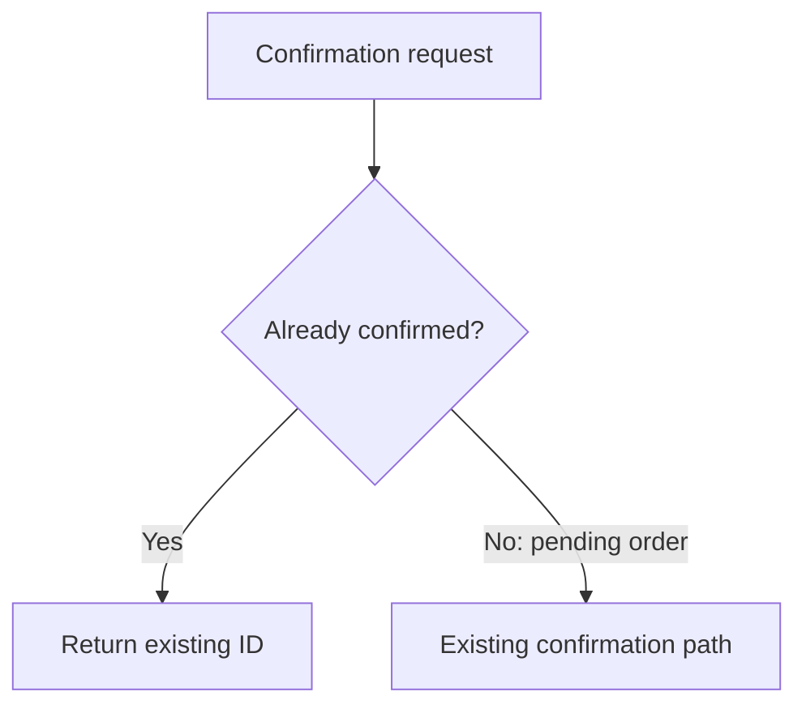

# Make repeated confirmation return the existing order

**Outcome:** let a caller repeat confirmation of an already-confirmed order without another reservation or event. The draft separates that sequential behavior from the still-unsettled concurrency and recovery contracts.

**Scope:** repeat-safe confirmation in a fictional order service. **Inspected source:** [sample-current](sample-record.md#L5). **History:** [invented decision record, iterations 1–2](sample-record.md#L19-L25).

**Readiness:** blocked for production handoff. Concurrency, publication recovery, and partial reservation rollback need resolution; a local sequential model can be explored independently ([scope](sample-record.md#L29)).

**Next step:** the concurrency and recovery choices still need evidence
before a supported recommendation. Proposed next step: inspect those boundaries
for [Complete the production contract](#complete-the-production-contract)
([gaps](sample-record.md#L23-L29)).

**Changed since iteration 1:** iteration 2 records the open concurrency choice and
an outbox proposal. The two earlier agreements remain recorded; the source does
not record a previous readiness state ([history](sample-record.md#L19-L29)).

> **Fictional example.** All decisions, including those labeled Agreed, belong to the invented sample record. They are not real user agreements or implementation results ([record](sample-record.md#L3)).

## Decisions

| Decision | Status | Meaning and evidence | Next action |
| --- | --- | --- | --- |
| [Return existing confirmation](#return-existing-confirmation) | Agreed | Fictional sample owner chose an early return for confirmed orders; sequential requests only ([record](sample-record.md#L19)) | Model the repeat through the handler's public interface |
| [Preserve stock rejection](#preserve-stock-rejection) | Agreed | Keep pending state, stock error, and no event for pending orders with unavailable stock ([record](sample-record.md#L21)) | Retain the rejection check; investigate partial rollback |
| [Coordinate concurrent requests](#coordinate-concurrent-requests) | Open | Locking versus an atomic state transition remains undecided ([record](sample-record.md#L23)) | Choose behavior and retry semantics before dependent production work |
| [Recover publication](#recover-publication) | Proposed | An outbox is only a candidate; transaction and deduplication behavior are unknown ([candidate](sample-record.md#L25)) | Inspect the boundary, then compare recovery options |

### Return existing confirmation

**Choice:** in the fictional agreement, read the stored state before reserving. If it is already confirmed, return the existing ID without another reserve or publish call ([decision](sample-record.md#L19)).

**Reason:** the stated intent is “A repeated confirmation of a confirmed order returns its existing ID without another reservation or confirmation event.” ([intent](sample-record.md#L17)). This guards the sequential repeat; it does not settle simultaneous requests ([open choice](sample-record.md#L23)).

**Acceptance:** proposed check — given a completed first confirmation, repeat the request; observe the same ID and no additional reserve or publish call ([check](sample-record.md#L27)).

**Delivery:** [Explore the sequential contract](#explore-the-sequential-contract)
models the agreement; [Complete the production contract](#complete-the-production-contract)
remains blocked ([scope](sample-record.md#L29)).

**Authority:** fictional individual answer by the sample product owner, iteration 1;
no real agreement or autopilot policy ([decision](sample-record.md#L19), [boundary](sample-record.md#L3)).

### Preserve stock rejection

**Preserved:** the fictional agreement keeps a rejected pending order pending, returns a stock error, and publishes no event. Partial rollback is still uninspected ([decision and limit](sample-record.md#L21)).

**Acceptance:** proposed check — given a pending order and unavailable stock,
confirmation returns the stock error, leaves the order pending, and publishes no
event; partial rollback remains a separate gap ([outcome](sample-record.md#L9), [check](sample-record.md#L27)).

**Delivery:** [Explore the sequential contract](#explore-the-sequential-contract)
models this rejection; [Complete the production contract](#complete-the-production-contract)
depends on the rollback investigation ([scope](sample-record.md#L29)).

**Authority:** fictional individual answer by the sample product owner, iteration 1
([decision](sample-record.md#L21), [fictional boundary](sample-record.md#L3)).

### Coordinate concurrent requests

**Open question:** should simultaneous confirmations serialize or race through an atomic state transition, and what should the losing caller receive? No choice or retry contract is agreed ([decision gap](sample-record.md#L23)).

### Recover publication

**Choice:** proposed only — evaluate an outbox. Transaction boundaries and consumer deduplication need evidence before agreement ([candidate](sample-record.md#L25)).

## Behavior at a glance

| Scenario | Current | Planned | Consumer consequence | Status and evidence |
| --- | --- | --- | --- | --- |
| First successful confirmation | Reserve every line, mark confirmed, publish, return ID | Preserve that successful path | The caller receives the confirmed ID after modeled publication succeeds | Agreed in the fictional record ([decision](sample-record.md#L19)); [current ordering](sample-record.md#L11) |
| Sequential repeat | Attempts reservation and publication again | Return the existing ID before those operations | The caller can repeat a completed confirmation without requesting another reservation or event | Agreed for sequential requests only ([decision](sample-record.md#L19)); [current behavior](sample-record.md#L13) |
| Stock unavailable | Pending state, stock error, no event | Preserve the rejection outcome | The caller still sees that confirmation did not complete | Agreed with a partial-rollback gap ([decision](sample-record.md#L21)) |
| Simultaneous confirmations | Not modeled | Unresolved: locking or atomic transition | The losing caller's result and retry behavior are undecided | Open ([decision gap](sample-record.md#L23)) |

## Before and after

Proposed view of the sequential-repeat agreement: add the stored-state guard before the existing pending-order path. This is planned behavior, not implemented code, and it makes no concurrency guarantee ([decision](sample-record.md#L19), [limit](sample-record.md#L23)).

Source map:
- Confirmation request — [current entry point](sample-record.md#L5).
- Already confirmed guard, added in the proposal — proposed: [return-existing decision](#return-existing-confirmation).
- Return existing ID — proposed: [return-existing decision](#return-existing-confirmation).
- Existing pending-order confirmation path — [preserved path](sample-record.md#L19), [ordering](sample-record.md#L7-L11).
- Request → stored-state check — proposed: [return-existing decision](#return-existing-confirmation).
- Confirmed → return ID without reserve or publish — proposed: [return-existing decision](#return-existing-confirmation).
- Pending → existing path — proposed: [return-existing decision](#return-existing-confirmation).

The current model attempts the full path again for a confirmed order; the planned guard returns before it. Rejection stays part of the pending-order path, as the scenario table records ([current](sample-record.md#L13), [preserved rejection](sample-record.md#L21)).

## Delivery slices

### Explore the sequential contract

**Scope:** proposed local model of [Return existing confirmation](#return-existing-confirmation) and [Preserve stock rejection](#preserve-stock-rejection), not production implementation ([boundary](sample-record.md#L29)).

**Verification:** proposed checks for the first call, a sequential repeat, and stock rejection at the handler interface. They need to assert both the returned ID or error and the reserve/publish calls ([checks](sample-record.md#L27)).

**Readiness:** a local model can be explored independently. Production handoff remains blocked by the three named gaps ([scope](sample-record.md#L29)).

### Complete the production contract

**Depends on:** the concurrency decision, publication recovery, and investigation of partial reservation rollback ([blockers](sample-record.md#L29)).

**Readiness:** blocked. No rollout or recovery contract is established by the current draft ([scope](sample-record.md#L29)).

## Verification

| Check or scenario | Result | Evidence origin | Revision and configuration | Scope and limits |
| --- | --- | --- | --- | --- |
| First confirmation ([proposed check](sample-record.md#L27)) | Not run | Proposed | No implementation; fictional sequential model | Must assert one reservation, one publication, and the returned ID |
| Sequential repeat ([proposed check](sample-record.md#L27)) | Not run | Proposed | No implementation; repeat after the first call completes | Would establish sequential behavior only |
| Stock rejection ([proposed check](sample-record.md#L27)) | Not run | Proposed | No implementation; unavailable stock | Partial rollback needs a separate investigation |

### Preservation coverage

This fictional matrix crosses pending/confirmed state with available/unavailable
stock for sequential requests. Empty cells expose missing observations; the source
model above is not a baseline run. Real configuration, interruption, and concurrency
axes still need inspection before production comparison ([model scope](sample-record.md#L5), [limits](sample-record.md#L15)).

| Scenario | Baseline observation | Candidate observation |
| --- | --- | --- |
| Pending; stock available | Empty: source model only, no application run ([ordering](sample-record.md#L7-L11)) | Empty: no implementation or tests ([limit](sample-record.md#L27)) |
| Pending; stock unavailable | Empty: source model only, no application run ([rejection](sample-record.md#L9)) | Empty: no implementation or tests ([limit](sample-record.md#L27)) |
| Confirmed; stock available | Empty: reservation acceptance is unknown ([repeat](sample-record.md#L13)) | Empty: no implementation or tests ([limit](sample-record.md#L27)) |
| Confirmed; stock unavailable | Empty: reservation acceptance is unknown ([repeat](sample-record.md#L13)) | Empty: no implementation or tests ([limit](sample-record.md#L27)) |

## Open questions

What concurrency result should each caller observe? What recovers a failed publication after the stored state changes? How are partially reserved lines released? These gaps block a production handoff, even if a future sequential model passes its checks ([scope](sample-record.md#L29)).

| Blocker | What would settle it | Affected work |
| --- | --- | --- |
| Unresolved concurrent confirmation ([gap](sample-record.md#L23)) | Inspect the boundary, then agree on coordination and the losing caller's result | [Complete the production contract](#complete-the-production-contract) |
| Unresolved publication recovery ([candidate](sample-record.md#L25)) | Inspect transaction and consumer boundaries, then choose recovery behavior | [Complete the production contract](#complete-the-production-contract) |
| Unknown partial reservation rollback ([limit](sample-record.md#L21)) | Investigate how partially reserved lines are released | [Complete the production contract](#complete-the-production-contract) |

## Evidence and record

The [fictional decision record](sample-record.md#L19-L25) is this sample's history. No production work, tests, or real agreement occurred ([boundary](sample-record.md#L3), [execution limit](sample-record.md#L27)). A real handoff would attach its feedback destination and record expected versus discovered behavior; this sample stops at a blocked draft. Presentation verification lives in [review.md](review.md).

## Status and label key

These labels describe separate judgments. Read each against its stated scope and evidence; no label alone establishes overall readiness or approval.

### Key: Verification results

| Option | Meaning |
| --- | --- |
| Passed | The recorded check met its expected outcome under the stated revision and conditions. This does not prove correctness outside that scope. |
| Failed | The recorded check did not meet its expected outcome. The result alone does not establish the cause or whether this change introduced it. |
| Mixed | The recorded checks or scenarios include both passing and failing outcomes; the report identifies which are which. |
| Not run | No execution result is claimed for this entry. Reading source or proposing a check does not count as running it. |
| Blocked | An identified obstruction prevented completion of the check. The report names it and retains any partial evidence. |

### Key: Verification evidence origins

| Option | Meaning |
| --- | --- |
| Executed here | The check was executed in this session, including delegated execution. Its command, result, revision, conditions, and limits are recorded. |
| Recorded run | The report cites an existing run, such as CI or an earlier experiment. Its original revision and conditions determine applicability. |
| Source inspected | Relevant code or assertions were read. Execution is not established, so the result is Not run. |
| Proposed | No execution evidence is claimed. The result is Not run or Blocked; Blocked names the obstruction that prevented the planned check. |

### Key: Decision statuses

| Option | Meaning |
| --- | --- |
| Agreed | A recorded individual answer or an explicitly authorized autopilot policy settles the choice. The report identifies that authority; agreement does not establish implementation or verification. |
| Proposed | A candidate for consideration; it has not been agreed. |
| Open | The desired behavior or choice remains undecided. |
| Reopened | A previously settled choice needs a new answer after changed evidence or scope. Its history is retained. |
| Superseded | A historical choice has been replaced by another decision. The report links its replacement. |

### Key: Diagram evidence

| Option | Meaning |
| --- | --- |
| observed | An identified current or recorded run produced the behavior shown. Retain its source snapshot, conditions, and evidence limits. |
| source | The diagram traces inspected source at its mapped lines. It does not claim runtime execution. |
| proposed | The diagram shows candidate behavior not established as implemented. Proposed elements map to decisions, requirements, or proposals; existing behavior still maps to source lines. Agreement is stated separately. |
