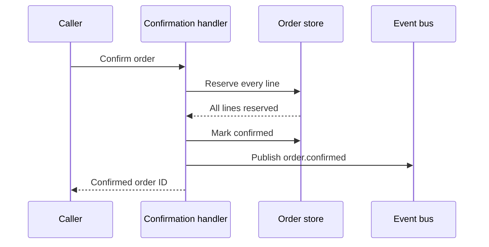

# How an order becomes confirmed

**Answer:** the fictional handler reserves stock, marks the order confirmed, then publishes an event. A later request repeats the work because the model has no already-confirmed guard. That ordering explains the retry concern; it establishes no concurrency or delivery guarantee.

**Scope:** one nonempty order, one request at a time. **Inspected source:** the invented [sample-current record](sample-record.md#L5), not application code. No tests were run.

**Read next:** follow the [successful request](#walkthrough), then compare [stock rejection and repeat requests](#alternatives).

> **Fictional example.** This page demonstrates the explanation template. Its behavior is invented, not a verified finding about a repository ([record](sample-record.md#L3)).

## Questions answered

| Question | Status | Answer and evidence | Follow-up |
| --- | --- | --- | --- |
| What completes a confirmation? | Answered | In the source model, reservation precedes the state write and publication; see the [walkthrough](#walkthrough) ([ordering](sample-record.md#L11)) | None for the modeled successful ordering; application behavior remains outside scope |
| Is repeating the request safe? | Partial | The model repeats reservation and publication; real inventory acceptance is unknown. See [alternatives](#alternatives) ([limit](sample-record.md#L13)) | Inspect the real inventory interface and exercise a sequential repeat |
| What recovers a failed publication? | Unresolved | Unknown; see [limits](#limits-and-next-questions) ([unmodeled boundary](sample-record.md#L15)) | Inspect the recovery path after the stored state changes |

## Mental model

In this source model, the handler coordinates the order store and event bus. Stock reservation precedes the stored confirmation state, and event publication follows that state write. The visible boundary matters: a stored confirmation is not proof of downstream delivery ([ordering](sample-record.md#L7-L11), [limits](sample-record.md#L15)).

Source-model sequence for a successful pending order: reservation completes before the state write and publication. The diagram covers one successful request only; alternatives follow below ([fictional model](sample-record.md#L5-L11)).



Source map:
- Caller — [sample actor](sample-record.md#L5).
- Confirmation handler — [sample actor](sample-record.md#L5).
- Order store — [sample actor](sample-record.md#L5).
- Event bus — [sample actor](sample-record.md#L5).
- Caller → handler, confirm order — [sample request](sample-record.md#L5).
- Handler → store, reserve every line — [reservation](sample-record.md#L7).
- Store → handler, all lines reserved — [successful result](sample-record.md#L7).
- Handler → store, mark confirmed — [state write](sample-record.md#L11).
- Handler → event bus, publish — [publication ordering](sample-record.md#L11).
- Handler → caller, return confirmed ID after publication succeeds — [response](sample-record.md#L11).

## Walkthrough

Illustrative input: follow order `sample-order` from pending to confirmed. The ID
is invented to connect the steps; no request was executed ([model boundary](sample-record.md#L3)).

### Reserve the order lines

**Trigger:** a caller confirms a pending order with enough stock in the fictional model ([starting condition](sample-record.md#L7)).

**State before:** the order is pending and reservation has not completed ([starting condition](sample-record.md#L7)).

**Action:** the handler requests reservation of every line and waits for the store's successful result ([reservation](sample-record.md#L7)).

**State after:** every line is reserved; the handler can proceed to confirmation ([result](sample-record.md#L7)).

For illustrative order `sample-order`, reservation has completed while the stored
state is still pending; the confirmation write comes next ([ordering](sample-record.md#L7-L11)).

### Store confirmation, then publish

**Action:** the handler changes the stored state to confirmed, asks for publication, and returns the order ID after publication succeeds ([ordering](sample-record.md#L11)).

**Why it matters:** publication failure after the write is unmodeled. The reader cannot infer recovery or downstream delivery from this successful path ([boundary](sample-record.md#L15)).

**Common misconception:** a stored confirmation proves event delivery. In this
model the write comes before publication, and downstream delivery is unmodeled
([ordering and limit](sample-record.md#L11-L15)).

Illustrative pseudocode for the source model, not an executable excerpt ([ordering](sample-record.md#L7-L11)).

```text url="sample-record.md#L7-L11" title="Illustrative ordering, not application code"
reserve every line
mark the order confirmed
publish order.confirmed
return the confirmed order ID
```

## Alternatives

| Scenario | Condition | Outcome | Why it matters | Evidence |
| --- | --- | --- | --- | --- |
| Stock unavailable | Pending order; reservation is rejected | Order stays pending; caller receives a stock error; no event is published | The caller cannot treat this rejection as a confirmed order | [Modeled rejection](sample-record.md#L9); partial rollback remains unknown |
| A sequential repeat | The stored order is already confirmed | Reservation and publication are attempted again | Repeating the request does not imply repeating only the response; real inventory acceptance is unknown | [Missing guard](sample-record.md#L13) |
| Publication fails | Reservation and confirmation state write have completed | Recovery and the caller's eventual result are unknown | A stored state does not prove that another service received the event | [Unmodeled boundary](sample-record.md#L15) |

## Limits and next questions

Concurrency, partial reservation rollback, client timeouts, and downstream delivery are outside this model. Inspect their controlling code and exercise the relevant failure boundaries before applying this explanation to a real system ([limits](sample-record.md#L9-L15)). The [planning sample](plan.md) illustrates how to retain those gaps while discussing a change.

## Evidence and record

Source: the [fictional record](sample-record.md#L3). The only snapshot is sample-current. No application source, runtime, test suite, or production measurement was inspected or executed. Presentation checks are recorded separately in [review.md](review.md).

## Status and label key

These labels describe separate judgments. Read each against its stated scope and evidence; no label alone establishes overall readiness or approval.

### Key: Question coverage

| Option | Meaning |
| --- | --- |
| Answered | Evidence supports the answer to the scoped learning question. |
| Partial | Part of the answer is supported; an explicit gap and the next useful check remain. |
| Unresolved | No answer is established yet. The report names the gap and what would settle it. |

### Key: Diagram evidence

| Option | Meaning |
| --- | --- |
| observed | An identified current or recorded run produced the behavior shown. Retain its source snapshot, conditions, and evidence limits. |
| source | The diagram traces inspected source at its mapped lines. It does not claim runtime execution. |
| proposed | The diagram shows candidate behavior not established as implemented. Proposed elements map to decisions, requirements, or proposals; existing behavior still maps to source lines. Agreement is stated separately. |
