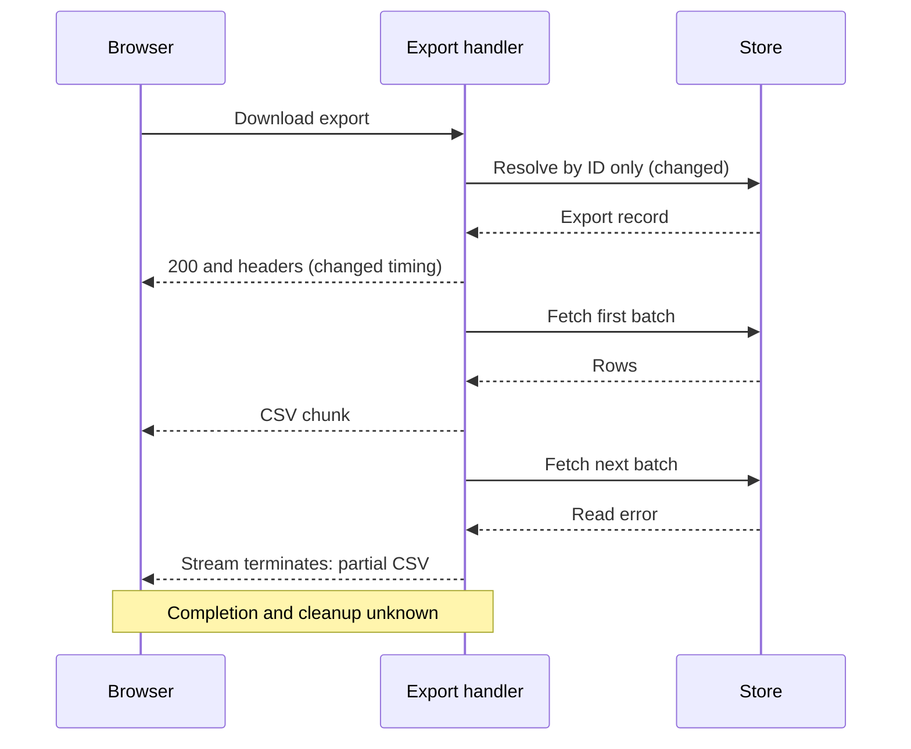
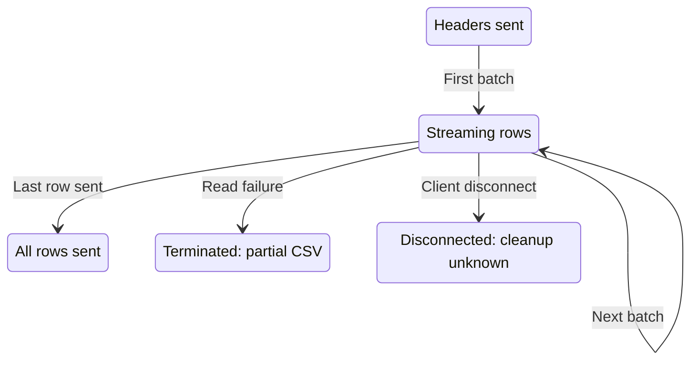
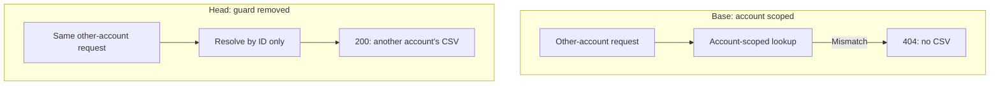

# Stream CSV exports in batches

**Bottom line:** the fictional comparison exposes an account-isolation failure and a missed attachment-memory target. Check those first, then settle incomplete-download handling and cancellation cleanup. Consumer behavior and deployment remain unverified.

**Reviewed:** fictional `sample-head` against `sample-base`; merge base `sample-base`. **Coverage:** a format demonstration using the [sample record](sample-evidence.md#L3), not an actual code review.

> **Fictional example.** All requirements, behavior, measurements, and recorded runs are invented. No application tests were executed. This example demonstrates report structure and evidence limits.

## What the change does

The proposed export sends rows in batches instead of assembling the whole CSV first. The intended benefit is lower memory use, but attachments still accumulate and failures can occur after response bytes have started. The lookup also loses account filtering. These are statements about the [fictional base and head](sample-evidence.md#L11-L12), not a real implementation. Follow [Streaming delivery](#streaming-delivery) for ordering and resource questions, and [Download ownership](#download-ownership) for the access-control difference.

## What to look at

1. **Another account receives the export** — *check it* · *documented*
   The fictional record changes a cross-account response from 404 to 200 with CSV data; this is new in the model ([comparison](sample-evidence.md#L17)).
   Look at: [Download ownership](#download-ownership), including the removed account constraint.
   Settle: does the request fail before any bytes are sent to another account?
2. **Attachments exceed the memory target** — *check it* · *documented*
   The invented memory record reports 146 MB with attachments against a 100 MB target; the plain-row result does not cover this case ([record](sample-evidence.md#L16)).
   Look at: [Streaming delivery](#streaming-delivery) and [Verification](#verification).
   Settle: does the attachment case stay below the target after the fix?
3. **An incomplete CSV needs a completion contract** — *ask the author* · *unknown*
   The fictional head can terminate after sending chunks; how clients detect that or safely retry is uninspected ([model](sample-evidence.md#L12), [consumers](sample-evidence.md#L32)).
   Look at: [Failure after response start](#failure-after-response-start).
   Settle: what completion signal and retry behavior should clients rely on?
4. **Cancellation cleanup is unverified** — *check it* · *unknown*
   Neither source inspection nor a run establishes resource release after a disconnect in the sample ([gap](sample-evidence.md#L18)).
   Look at: [Streaming delivery](#streaming-delivery) and its cancellation scenario.
   Settle: are open resources released when the client disconnects?

## Possible bugs

The search for bugs has not run: this fictional example demonstrates the report format, and no application was probed.

## Requirements

| Requirement and intent | Status | Behavior and evidence | Next action |
| --- | --- | --- | --- |
| "Export all 2,400 matching rows in order for the agreed plain-row fixture" ([intent](sample-evidence.md#L5)) | Met | [Streaming delivery](#streaming-delivery): the fictional 2,400-row fixture matches; broader inputs remain unknown | None for this fixture; retain the scope limit |
| "Keep peak export memory below 100 MB, including attachments" ([intent](sample-evidence.md#L6)) | Partial | [Streaming delivery](#streaming-delivery): the fictional plain-row case passes; attachments exceed the target | Stream attachments, then repeat the memory check |
| "Only the requesting account can download its exports" ([intent](sample-evidence.md#L7)) | Unmet | [Download ownership](#download-ownership): the fictional head returns another account's CSV | Restore account filtering before output starts |
| "Release resources when the client disconnects" ([intent](sample-evidence.md#L8)) | Not verified | [Streaming delivery](#streaming-delivery): cleanup is not inspected or exercised | Check cancellation and resource release |
| Inferred candidate: clients must detect incomplete downloads; [intent is unspecified](sample-evidence.md#L9) | Needs clarification | [Streaming delivery](#streaming-delivery): failure after headers is possible in the model; consumer interpretation is unknown | Agree the completion and retry contract |

The [fictional record](sample-evidence.md#L3) limits these rows to the sample; they do not establish merge readiness for a real PR. The [status key](#key-requirement-fulfillment) explains all available fulfillment states.
## Behavior changes

### Streaming delivery

**Purpose and tradeoff:** the documented target is "Keep peak export memory below 100 MB, including attachments" ([intent](sample-evidence.md#L6)). Streaming reduces the amount of plain-row data buffered in the fictional model, but a read failure can now follow response start ([base/head](sample-evidence.md#L11-L12)). Consumer handling of that outcome is unknown.

**Conditions:** a client downloads a matching export; batch reads, attachments, failure timing, and interruption vary. The sample models the direct route only; authenticated middleware, proxies, and deployed configurations remain uninspected ([model](sample-evidence.md#L12)).

| Scenario | Before | After | Consumer consequence | Evidence |
| --- | --- | --- | --- | --- |
| Ordinary plain rows | Assemble all rows before sending | Send each batch as available | Client receives the same modeled rows and order | [Model](sample-evidence.md#L13); [fictional fixture](sample-evidence.md#L15) |
| Row read fails | 500 before CSV bytes | If headers and earlier chunks were sent, terminate the stream | Client receives partial output; its completion decision is unknown | [Base/head](sample-evidence.md#L11-L12); [failure edge](sample-evidence.md#L29) |
| Attachments included | Comparable measurement unavailable | Invented peak of 146 MB | Memory target remains unmet for this case | [Sample memory record](sample-evidence.md#L16) |
| Client disconnects | Cleanup not inspected | Cleanup not inspected | Resource retention is unknown at both snapshots | [Gap](sample-evidence.md#L18) |
| Authenticated middleware or proxy | Not inspected | Not inspected | Whether wrapping changes failure or cleanup is unknown | [Scope limit](sample-evidence.md#L12) |

Illustrative pseudocode for the documented model, not a source diff. It preserves the ordering question while omitting unsupported cleanup details ([model](sample-evidence.md#L11-L12)).

```text url="sample-evidence.md#L11-L12" title="Illustrative pseudocode — not executable source"
base: fetch all rows -> assemble CSV -> send headers and bytes
head: send headers -> fetch batch -> send chunk -> repeat
```

#### Failure after response start

Proposed failure trace in the fictional head: one batch succeeds, then the next read fails after headers and CSV bytes have reached the browser. This follows one possible path; normal continuation is shown in the lifecycle below. Browser interpretation and cancellation cleanup remain unknown ([model](sample-evidence.md#L12), [read outcomes](sample-evidence.md#L27-L29)).



Source map:
- Browser — [sample actor](sample-evidence.md#L20).
- Export handler — [sample actor](sample-evidence.md#L21).
- Store — [sample actor](sample-evidence.md#L22).
- Browser → Export handler, download — [sample edge](sample-evidence.md#L23).
- Export handler → Store, ID lookup — [sample edge](sample-evidence.md#L24).
- Store → Export handler, export record — [sample edge](sample-evidence.md#L25).
- Export handler → Browser, headers before reads — [sample edge](sample-evidence.md#L26).
- Export handler → Store, first batch — [sample edge](sample-evidence.md#L27).
- Store → Export handler, rows — [sample edge](sample-evidence.md#L28).
- Export handler → Browser, CSV chunk — [sample edge](sample-evidence.md#L28).
- Export handler → Store, next batch — [sample edge](sample-evidence.md#L27).
- Store → Export handler, read error — [sample edge](sample-evidence.md#L29).
- Export handler → Browser, terminated stream — [sample edge](sample-evidence.md#L29).
- Completion and cleanup unknown — [sample gap](sample-evidence.md#L18), [consumer boundary](sample-evidence.md#L32).

#### Completion and interruption boundaries

Proposed lifecycle for a nonempty fictional export: sending every row, a failed read, and a disconnected client lead to different outcomes. These are explanatory states, not inspected implementation enums. “All rows sent” describes server output; client confirmation and cleanup remain unverified ([lifecycle model](sample-evidence.md#L35)).



Source map:
- Headers sent — [lifecycle model](sample-evidence.md#L35), [headers edge](sample-evidence.md#L26).
- Streaming rows — [lifecycle model](sample-evidence.md#L35).
- All rows sent, server output only — [lifecycle model](sample-evidence.md#L35).
- Terminated with partial CSV — [failure edge](sample-evidence.md#L29).
- Disconnected, cleanup unknown — [lifecycle model](sample-evidence.md#L35), [inspection gap](sample-evidence.md#L18).
- Headers → Streaming, first batch — [lifecycle model](sample-evidence.md#L35).
- Streaming → Streaming, next batch — [lifecycle model](sample-evidence.md#L35).
- Streaming → All rows sent, last row — [lifecycle model](sample-evidence.md#L35).
- Streaming → Terminated, read failure — [lifecycle model](sample-evidence.md#L35), [failure edge](sample-evidence.md#L29).
- Streaming → Disconnected, client disconnect — [lifecycle model](sample-evidence.md#L35).

**Consumers:** the browser downloader and an automated importer receive CSV. Their treatment of truncation and their retry behavior are uninspected. A second import duplicating records is a question to investigate, not an established defect ([consumer boundary](sample-evidence.md#L32)).

**Preserved:** row selection, order, and column names are unchanged within the fictional model; only the listed plain-row fixture is supported by sample results ([preservation scope](sample-evidence.md#L13)).

**Depends on:** useful memory bounds require attachments to stream too; plain-row results cannot establish that condition ([sample record](sample-evidence.md#L16)).

**Deployment:** mixed-version clients, proxies, cleanup monitoring, and rollback effects are uninspected. The unchanged modeled route and fields do not establish operational compatibility ([boundary](sample-evidence.md#L33)).

**Open question:** which completion signal lets each consumer reject partial output, and what makes a retry safe?

See the incomplete-CSV and cancellation actions in [What to look at](#what-to-look-at).

### Download ownership

**Purpose and tradeoff:** the lookup was simplified in the fictional head, but the documented requirement remains "Only the requesting account can download its exports" ([intent](sample-evidence.md#L7)). No author rationale for removing the account constraint is available ([comparison](sample-evidence.md#L11-L12)).

**Conditions:** a caller requests an export belonging to another account. The fictional record isolates the account mismatch; public URLs and alternate download paths are uninspected ([sample case](sample-evidence.md#L17)).

| Scenario | Before | After | Consumer consequence | Evidence |
| --- | --- | --- | --- | --- |
| Another account requests the ID | 404; no CSV | 200 with CSV data | Caller receives another account's export; new failure in this model | [Fictional comparison](sample-evidence.md#L17) |
| Owning account requests the ID | Account-scoped lookup | ID-only lookup | Intended access still possible in the model; alternate paths unknown | [Source model](sample-evidence.md#L11-L12) |

#### The missing ownership guard

Source-model comparison for the same cross-account request: base rejects it with 404; head resolves by ID and returns CSV. These are two snapshots of one case, not parallel runtime branches. Owning-account requests and alternative paths are outside this diagram ([fictional comparison](sample-evidence.md#L17)).



Source map:
- Base group, account-scoped snapshot — [base model](sample-evidence.md#L11).
- Other-account request at base — [sample input](sample-evidence.md#L17).
- Account-scoped lookup — [base constraint](sample-evidence.md#L11).
- 404, no CSV — [base outcome](sample-evidence.md#L17).
- Request → account check — [base lookup](sample-evidence.md#L11).
- Account mismatch → 404 — [base outcome](sample-evidence.md#L17).
- Head group, removed guard — [head model](sample-evidence.md#L12).
- Same other-account request at head — [sample input](sample-evidence.md#L17).
- Resolve by ID only — [head lookup](sample-evidence.md#L12).
- 200, another account's CSV — [head outcome](sample-evidence.md#L17).
- Request → ID lookup — [head model](sample-evidence.md#L12).
- ID lookup → CSV response — [head outcome](sample-evidence.md#L17).

Illustrative contract difference, not an actual code excerpt ([model](sample-evidence.md#L31)).

```diff url="sample-evidence.md#L31" title="Illustrative lookup contract"
- resolve_export(export_id, requesting_account_id)
+ resolve_export(export_id)
```

**Consumers:** the download caller crosses the account boundary. An independent guard could change the conclusion, but none is established in the fictional record ([model](sample-evidence.md#L12)).

**Preserved:** the fictional route and CSV fields remain the same; that does not preserve account isolation ([interface](sample-evidence.md#L33)).

**Open question:** is account ownership enforced before the stream starts on every supported download path?

See the account-isolation action in [What to look at](#what-to-look-at).

## Questions for the author

- What completion signal and retry behavior should clients rely on? See [Failure after response start](#failure-after-response-start) and its attention item in [What to look at](#what-to-look-at).
- Is there an independent account guard before output starts? See [Download ownership](#download-ownership).

## Verification

Tests inspected: no real assertions. Recorded runs: invented fixture records only. Executed: no application checks. Every Recorded run row below is fictional sample data.

| Check or scenario | Result | Evidence origin | Revision and configuration | Scope and limits |
| --- | --- | --- | --- | --- |
| [Row count and ordering](sample-evidence.md#L15) | Passed | Recorded run | Fictional sample-head; 2,400 plain rows | One invented case; no broader correctness claim |
| [Peak memory](sample-evidence.md#L16) | Mixed | Recorded run | Fictional sample-head; plain rows and attachments | No base measurement or repetitions; no speedup or distribution claim |
| [Account isolation](sample-evidence.md#L17) | Failed | Recorded run | Fictional base/head; direct route, account mismatch | Supports this sample path only |
| [Failure after response start](#failure-after-response-start) | Not run | Source inspected | Fictional sequence model only | Real browser completion behavior unknown |
| [Cancellation cleanup](sample-evidence.md#L18) | Not run | Proposed | Base/head and deployed wrappers to be checked | No resource-release result exists |
| [Bug probes](#possible-bugs) | Not run | Proposed | No application was probed | This fictional example has no probe results |

## Evidence and record

### Gaps

Unknown: deployed wrappers, consumer completion detection, safe retries, resource cleanup, and operational compatibility. The same limits remain beside their affected conclusions. No performance chart is shown: the invented memory values have neither repeated observations nor a comparable baseline ([record](sample-evidence.md#L16)).

### Changed files

This demonstration has no actual source diff. Its [sample record](sample-evidence.md#L3) defines every modeled behavior and evidence limit. No real application files were inspected.

### Provenance

Fictional revisions sample-head and sample-base, not Git commits. No CI, benchmark, or application execution occurred. The diagram illustrates the same fictional model as the Markdown; its source map identifies individual sample statements. This file demonstrates the report format, not a review completion or merge decision.

## Status and label key

These labels describe separate judgments. Read each against its stated scope and evidence; no label alone establishes overall readiness or approval.

### Key: Requirement fulfillment

| Option | Meaning |
| --- | --- |
| Met | Evidence supports the whole stated requirement within its conditions. Remaining evidence gaps must still be named. |
| Partial | Some required conditions hold; the report names the remainder. |
| Unmet | Evidence shows that a required condition fails. |
| Not verified | Intent is clear, but evidence is insufficient to decide whether the requirement holds. |
| Needs clarification | Intent is missing, ambiguous, or conflicting. Retain conflicting statements and label any candidate interpretation as inferred. |
| Not applicable | A recorded, agreed scope decision excludes the requirement; the report links that decision and gives the reason. |

### Key: Verification results

| Option | Meaning |
| --- | --- |
| Passed | The recorded check met its expected outcome under the stated revision and conditions. This does not prove correctness outside that scope. |
| Failed | The recorded check did not meet its expected outcome. The result alone does not establish the cause or whether this change introduced it. |
| Mixed | The recorded checks or scenarios include both passing and failing outcomes; the report identifies which are which. |
| Not run | No execution result is claimed for this entry. Reading source or proposing a check does not count as running it. |
| Blocked | An identified obstruction prevented completion of the check. The report names it and retains any partial evidence. |

### Key: Verification evidence origins

| Option | Meaning |
| --- | --- |
| Executed here | The check was executed in this session, including delegated execution. Its command, result, revision, conditions, and limits are recorded. |
| Recorded run | The report cites an existing run, such as CI or an earlier experiment. Its original revision and conditions determine applicability. |
| Source inspected | Relevant code or assertions were read. Execution is not established, so the result is Not run. |
| Proposed | No execution evidence is claimed. The result is Not run or Blocked; Blocked names the obstruction that prevented the planned check. |

### Key: Review actions

| Option | Meaning |
| --- | --- |
| you decide | A behavior or tradeoff needs a choice from the reviewer or author. |
| check it | Confirm a specific claim at the code or with a scoped run. |
| ask the author | The author needs to supply information or confirm a choice the available evidence cannot settle. |
| read lightly | Evidence covers the whole named part and its relevant preservation claim, so a lighter read is justified within that boundary. |
| no action | The report records a known point that requires no action today. This is not approval of the whole change. |

### Key: Review evidence labels

| Option | Meaning |
| --- | --- |
| we ran it | An executed run produced the stated observation or measurement within its recorded conditions. A retained earlier result keeps its original provenance and is identified as Recorded run in Verification. |
| read at the line | The claim follows the inspected, pinned source lines; this is not a runtime result. |
| documented | Quoted documentation or a recorded statement establishes intent, not implemented behavior. |
| reasoned, not run | An inference from named evidence and reasoning; the predicted behavior was not executed. |
| not read | The relevant source was not inspected. No behavior claim is established for that boundary. |
| unknown | Available evidence does not settle the claim. The report states what would settle it. |

### Key: Diagram evidence

| Option | Meaning |
| --- | --- |
| observed | An identified current or recorded run produced the behavior shown. Retain its source snapshot, conditions, and evidence limits. |
| source | The diagram traces inspected source at its mapped lines. It does not claim runtime execution. |
| proposed | The diagram shows candidate behavior not established as implemented. Proposed elements map to decisions, requirements, or proposals; existing behavior still maps to source lines. Agreement is stated separately. |
