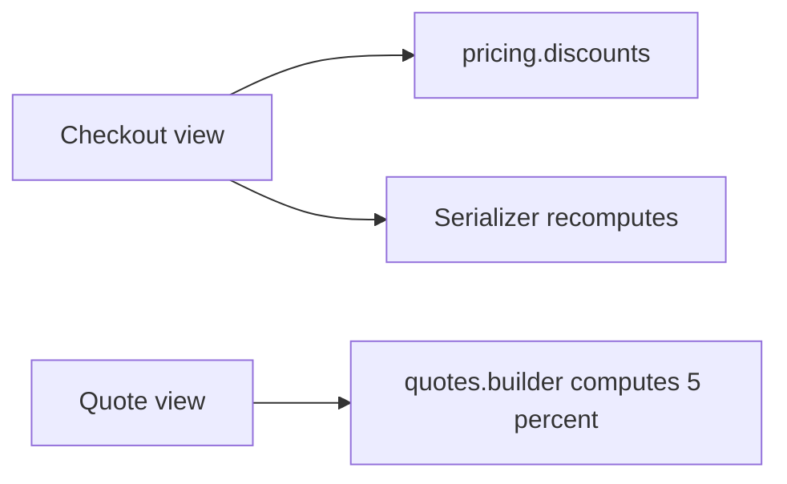

# Pricing: what to fix, and how

## In short

**The problem:** The loyalty discount is decided in three files that disagree, so a gold customer is quoted 38.00 and charged 36.00 for the same basket, and every change to a rate must find all three (observed in the [probe](runs/probe_loyalty.py)).

**What we propose:** *Pricing owns discounts*: one function decides the rate, both entry points call it, and `discounts.py` is renamed `loyalty.py` for the rule it owns. Two lock tests come first; three files and two call sites change (proposed).

**What you decide:** Whether `apply_legacy_rounding` is still needed: open, and it stays until you answer. Which gold rate is right, a possible bug found on the way: you answered 10% on 2 June.

**Scope:** `shop/pricing/` and the serializers and views that call it; tax is excluded. **Inspected source:** commit `ddddddd` of the fictional `acme/shop`, no local changes. **What ran:** `python -m pytest tests/pricing -q`, 42 passed ([baseline run](runs/baseline.md)).

> **Fictional example.** This note demonstrates the rework-map template. Its shop, files, and runs are invented.

## What it does

This is the behavior the rework keeps. The tests named verify it, as observed in the [baseline run](runs/baseline.md), and a lock test records what no test did.

### Loyalty discount

- **A gold customer gets 10% off at checkout.** When a gold customer checks out, the total is the subtotal less 10%, from [views.py:31](https://github.com/acme/shop/blob/dddddddddddddddddddddddddddddddddddddddd/shop/api/views.py#L31). *Verified by:* tested, 3 tests turned red when the rate at [discounts.py:12](https://github.com/acme/shop/blob/dddddddddddddddddddddddddddddddddddddddd/shop/pricing/discounts.py#L12) was broken ([baseline run](runs/baseline.md)).
- **A silver customer gets 5% off.** When a silver customer checks out, the total is the subtotal less 5%. *Verified by:* tested, by the same 3 tests ([baseline run](runs/baseline.md)).
- **A quote shows the total a customer would pay.** When a customer asks for a quote, the response holds a total; for a gold customer it is the subtotal less 5% today, from [views.py:58](https://github.com/acme/shop/blob/dddddddddddddddddddddddddddddddddddddddd/shop/api/views.py#L58). *Verified by:* locked, `test_gold_quote_records_38` (problem 3 questions the rate).
- **The order JSON shows the discount.** When a customer checks out, the JSON holds the discount it applied. *Verified by:* locked, `test_checkout_discount_shown`.
- **A guest pays full price.** When a customer has no tier, no discount applies, from [discounts.py:20](https://github.com/acme/shop/blob/dddddddddddddddddddddddddddddddddddddddd/shop/pricing/discounts.py#L20). *Verified by:* tested, `test_guest_pays_full_price`.

### Coupon

- **Coupons are not described here.** The user ranked them second; their behavior was not inspected. *Verified by:* untested, not inspected.

## How the code carries it

One of the four behaviors drawn is decided in more than one file: the gold rate, at `discounts.py:12` and again at `serializers.py:44`; quotes keep a third copy at `builder.py:27`.

```behavior-map
{"files": [{"id": "views", "path": "shop/api/views.py"}, {"id": "serializers", "path": "shop/api/serializers.py"},
           {"id": "builder", "path": "shop/quotes/builder.py"}, {"id": "discounts", "path": "shop/pricing/discounts.py"}],
 "behaviors": [
  {"feature": "Loyalty discount", "name": "A gold customer gets 10% off at checkout",
   "sites": [{"file": "views", "at": "shop/api/views.py:31", "role": "calls"}, {"file": "discounts", "at": "shop/pricing/discounts.py:12", "role": "decides"},
             {"file": "serializers", "at": "shop/api/serializers.py:44", "role": "decides"}],
   "weak": "the rate is decided again for display", "problem": 1},
  {"feature": "Loyalty discount", "name": "A quote shows the total a customer would pay",
   "sites": [{"file": "views", "at": "shop/api/views.py:58", "role": "calls"}, {"file": "builder", "at": "shop/quotes/builder.py:27", "role": "decides"}],
   "weak": "quotes keep their own copy of the rate", "problem": 1},
  {"feature": "Loyalty discount", "name": "The order JSON shows the discount",
   "sites": [{"file": "views", "at": "shop/api/views.py:36", "role": "stores"}, {"file": "serializers", "at": "shop/api/serializers.py:44", "role": "decides"}]},
  {"feature": "Loyalty discount", "name": "A guest pays full price",
   "sites": [{"file": "discounts", "at": "shop/pricing/discounts.py:20", "role": "decides"}]}
 ]}
```

## Problems

### 1. Changing a loyalty rate takes three edits

**Kind:** scattered rule · **How sure:** source, read at the lines, and history · **Cost today:** 3 files per rate change; the rate changed 4 times, and 2 of those changes missed a file

**What is wrong:** One rule, the discount for each tier, is decided in `pricing`, again in the API serializer for display, and again in quotes. Nothing in the code ties the three together, so a person changing a rate must know all of them. Two of the four changes in the history missed one, and that is how problem 3 began (source, at the pinned lines; history from `git log -L`).

```structure-focus
{"rules": ["Loyalty discount rate"]}
```

**Evidence:**

```python url="https://github.com/acme/shop/blob/dddddddddddddddddddddddddddddddddddddddd/shop/pricing/discounts.py#L12-L13"
RATES = {"gold": Decimal("0.10"), "silver": Decimal("0.05")}
return subtotal * RATES.get(tier, Decimal("0"))
```

```python url="https://github.com/acme/shop/blob/dddddddddddddddddddddddddddddddddddddddd/shop/api/serializers.py#L44-L46"
if tier == "gold":
    discount = subtotal * Decimal("0.10")
elif tier == "silver":
```

- `discounts.py` and `builder.py` changed together in 6 commits with no dependency between them (`change_coupling.py --edges`).

**Proposed fix:** *Pricing owns discounts*: `loyalty_discount(tier, subtotal)` at [discounts.py:12](https://github.com/acme/shop/blob/dddddddddddddddddddddddddddddddddddddddd/shop/pricing/discounts.py#L12) is the only place that knows a rate; the serializer and the quote builder call it. The steps are in [the plan](#the-plan).

**Cost and risk:** 3 files and 2 call sites change; 2 lock tests come first (proposed). The quote call waits for the answer to problem 3, now given.

**What you get:** the next rate change is one edit in one file; decision sites for the rule go from 3 to 1, and the stated rule "every price is decided in `pricing`" holds again (proposed).

**Other options:**

- **Leave it:** every rate change keeps touching three files, and the next missed file is found by a customer (inferred from the history).
- **A shared rate table that the three sites read:** removes the disagreement, but three places still apply the rate (proposed).

**Decision:** decided: *Pricing owns discounts* (the user, 2 June).

### 2. `apply_legacy_rounding` has no caller

**Kind:** unjustified special case · **How sure:** observed, removal probe · **Cost today:** none: the file changed once

**What is wrong:** [rounding.py:8](https://github.com/acme/shop/blob/dddddddddddddddddddddddddddddddddddddddd/shop/pricing/rounding.py#L8) defines `apply_legacy_rounding`, nothing in the repository calls it, and no test fails without it; we ran the removal probe ([baseline run](runs/baseline.md)). A caller outside the repository is not excluded, so it stays until you say.

**Proposed fix:** Delete it once you confirm no outside caller uses it.

**Decision:** open. Recommended: delete it. Until you answer, it stays.

### 3. A gold customer is quoted 38.00 and charged 36.00

**Kind:** behavior to decide · **How sure:** observed, we ran both paths · **Cost today:** every gold quote is wrong by 5% of the basket

**What is wrong:** Checkout takes 10% off for a gold customer and a quote takes 5%, so the quote promises a price the customer is never charged. The quote path copied the rate in 2023, while gold was 5%, and the change to 10% reached only `pricing` ([probe](runs/probe_loyalty.py)).

```change-history
{
 "rule": "Loyalty discount rate",
 "sites": [
  {"id": "discounts", "label": "pricing/discounts.py:12"},
  {"id": "serializers", "label": "api/serializers.py:44"},
  {"id": "builder", "label": "quotes/builder.py:27", "since": "3be62b3"}
 ],
 "commits": [
  {"sha": "1a2b3c4", "date": "2022-11-04", "subject": "Silver tier at 5%", "changed": ["discounts", "serializers"]},
  {"sha": "3be62b3", "date": "2023-02-17", "subject": "Quotes compute the discount locally", "changed": ["builder"]},
  {"sha": "93548a8", "date": "2023-09-01", "subject": "Raise gold to 10%", "changed": ["discounts", "serializers"]},
  {"sha": "c0ffee1", "date": "2024-01-12", "subject": "Round the display discount", "changed": ["serializers"]}
 ]
}
```

**Evidence:**

```python url="https://github.com/acme/shop/blob/dddddddddddddddddddddddddddddddddddddddd/shop/pricing/discounts.py#L12-L13"
RATES = {"gold": Decimal("0.10"), "silver": Decimal("0.05")}
return subtotal * RATES.get(tier, Decimal("0"))
```

```python url="https://github.com/acme/shop/blob/dddddddddddddddddddddddddddddddddddddddd/shop/quotes/builder.py#L26-L28"
def discount_for(customer, subtotal):
    if customer.tier == "gold":
        return subtotal * Decimal("0.05")
```

- The probe ran a 40.00 basket for a gold customer through both entry points: checkout 36.00, quote 38.00 ([probe](runs/probe_loyalty.py)).
- No test protects the quote rate: changed to 50% in a scratch worktree, all 42 tests stayed green ([baseline run](runs/baseline.md)).

**Proposed fix:** Hand it to fix-bug with your answer: quotes call `loyalty_discount` and charge 10%. It is a behavior change, so it is not a rework step.

**Decision:** decided: 10% is right; "the quote path was never updated" (the user, 2 June).

## The plan

**Recommended:** *Pricing owns discounts*, proposed because the rule changes often and its places already disagree. **Chosen:** *Pricing owns discounts* (the user, 2 June).

The files by design part, the dependencies the code has, and where each rule is decided, today and under the plan (source, at the pinned lines in the data; the loyalty paths ran in the [probe](runs/probe_loyalty.py)).

```structure-view
{
 "parts": [
  {
   "id": "api",
   "label": "API",
   "said": "only translates requests"
  },
  {
   "id": "quotes",
   "label": "Quotes",
   "said": "uses pricing"
  },
  {
   "id": "pricing",
   "label": "Pricing",
   "said": "every price is decided here"
  },
  {
   "id": "storage",
   "label": "Storage",
   "said": "customer records"
  }
 ],
 "files": [
  {
   "id": "views",
   "path": "shop/api/views.py",
   "part": "api"
  },
  {
   "id": "serializers",
   "path": "shop/api/serializers.py",
   "part": "api"
  },
  {
   "id": "builder",
   "path": "shop/quotes/builder.py",
   "part": "quotes"
  },
  {
   "id": "discounts",
   "path": "shop/pricing/discounts.py",
   "part": "pricing",
   "renamed": "shop/pricing/loyalty.py"
  },
  {
   "id": "rounding",
   "path": "shop/pricing/rounding.py",
   "part": "pricing"
  },
  {
   "id": "accounts",
   "path": "shop/accounts.py",
   "part": "storage"
  }
 ],
 "dependencies": [
  {
   "from": "views",
   "to": "discounts",
   "today": "as stated",
   "proposed": "as stated",
   "at": "shop/api/views.py:4",
   "why": "The design allows API to use pricing."
  },
  {
   "from": "views",
   "to": "builder",
   "today": "as stated",
   "proposed": "as stated",
   "at": "shop/api/views.py:5",
   "why": "The design allows API to use quotes."
  },
  {
   "from": "builder",
   "to": "discounts",
   "today": "not found",
   "proposed": "as stated",
   "at": "shop/quotes/builder.py:27",
   "why": "The design says quotes uses pricing; the builder computes the discount itself."
  },
  {
   "from": "serializers",
   "to": "accounts",
   "today": "not stated",
   "proposed": null,
   "at": "shop/api/serializers.py:9",
   "why": "Only pricing may read customer records."
  },
  {
   "from": "discounts",
   "to": "accounts",
   "today": "as stated",
   "proposed": "as stated",
   "at": "shop/pricing/discounts.py:3",
   "why": "Pricing reads the tier."
  }
 ],
 "rules": [
  {
   "name": "Loyalty discount rate",
   "owner": "discounts",
   "outcome": "moves",
   "note": "The quote rate waits for the decision on which rate is right.",
   "sites": [
    {
     "file": "discounts",
     "at": "shop/pricing/discounts.py:12",
     "what": "gold 10%, silver 5%"
    },
    {
     "file": "serializers",
     "at": "shop/api/serializers.py:44",
     "what": "recomputed for display"
    },
    {
     "file": "builder",
     "at": "shop/quotes/builder.py:27",
     "what": "gold 5%",
     "waits": true
    }
   ]
  },
  {
   "name": "A guest pays full price",
   "owner": "discounts",
   "outcome": "stays",
   "note": "Pinned by a test; fine.",
   "sites": [
    {
     "file": "discounts",
     "at": "shop/pricing/discounts.py:20",
     "what": "no tier, no discount"
    }
   ]
  }
 ],
 "data": [
  {
   "name": "The order dict",
   "proposed": "an Order value with declared fields, built once in views.py",
   "keys": [
    {
     "key": "discount",
     "writes": [
      {
       "file": "views",
       "at": "shop/api/views.py:36"
      },
      {
       "file": "serializers",
       "at": "shop/api/serializers.py:44"
      }
     ],
     "reads": [
      {
       "file": "views",
       "at": "shop/api/views.py:41",
       "default": "0"
      }
     ]
    }
   ]
  }
 ]
}
```


### Pricing owns discounts

**Owners:** proposed: `shop/pricing/discounts.py` decides the loyalty rate; `api` and `quotes` call it.

**Interface:** proposed: `loyalty_discount(tier, subtotal) -> Decimal`, the function that exists today at [discounts.py:12](https://github.com/acme/shop/blob/dddddddddddddddddddddddddddddddddddddddd/shop/pricing/discounts.py#L12).

**Guarantees at the boundary:** proposed: none new; the guest default stays where it is.

**Data and state:** proposed: an `Order` value with declared fields, built once in `views.py`, in place of the `order` dict two files write.

**Flow:** proposed: calls move one way, API and quotes to pricing to storage; the serializer's read of customer records, against that order, goes.

**Failure behavior:** proposed: unchanged. No fallback is in scope.

**Measure:** decision sites for the loyalty rate go from 3 to 1; the stated rule "every price is decided in `pricing`" holds (proposed).

### Module changes

- **Rename** `shop/pricing/discounts.py` to `shop/pricing/loyalty.py` (proposed): it owns the loyalty rule, and "discounts" also names coupons, which it does not decide. Problem 1.
- **Move** the tier lookup out of `shop/api/serializers.py` into `shop/pricing/loyalty.py` (proposed): the API translates requests and decides nothing about money, as the design states. Problem 1.

### Lock tests

- `test_gold_quote_records_38` in `tests/quotes/test_lock.py` locks that a gold quote for a 40.00 basket is 38.00, a value under decision. It failed with the quote rate changed to 50% at [builder.py:27](https://github.com/acme/shop/blob/dddddddddddddddddddddddddddddddddddddddd/shop/quotes/builder.py#L27); the suite then passed, 43 tests ([baseline run](runs/baseline.md)).
- `test_checkout_discount_shown` in `tests/api/test_lock.py` locks that the order JSON shows a 4.00 discount for a gold 40.00 basket. It failed with the display rate changed at [serializers.py:44](https://github.com/acme/shop/blob/dddddddddddddddddddddddddddddddddddddddd/shop/api/serializers.py#L44); the suite then passed, 43 tests ([baseline run](runs/baseline.md)).

### Steps

1. Pin, proposed, structural: the two lock tests above.
2. Gather, proposed, structural: make `serializers.py` call `loyalty_discount` in place of its own condition; 1 call site; proof is the pins green and the same checkout total, 36.00.
3. Lock in, proposed, structural: add `quotes` to `pricing` to the stated design file and run `design_conformance.py` in the project's checks.

Waiting for fix-bug, not a rework step: moving `builder.py` to `loyalty_discount` changes the quote total from 38.00 to 36.00, as problem 3 says (proposed).

## What is sound

- Rounding happens once, in [rounding.py:3](https://github.com/acme/shop/blob/dddddddddddddddddddddddddddddddddddddddd/shop/pricing/rounding.py#L3), as the design says; a search for `quantize` and `round(` found no other site.
- [discounts.py:20](https://github.com/acme/shop/blob/dddddddddddddddddddddddddddddddddddddddd/shop/pricing/discounts.py#L20) returns 0 for a missing tier. It looks like a swallowed case and is the guest-checkout rule, documented in its commit and pinned by a test.

## How it works today

### Deliberate breaks

- The quote rate for gold customers: with [builder.py:27](https://github.com/acme/shop/blob/dddddddddddddddddddddddddddddddddddddddd/shop/quotes/builder.py#L27) changed from 5% to 50% in a scratch worktree, all 42 tests stayed green; we ran it ([baseline run](runs/baseline.md)).
- The checkout rate at `discounts.py:12`: the break turned 3 tests red ([baseline run](runs/baseline.md)).

### Stated design and the code

The design is stated in the project's architecture page: "The API layer only translates requests; every price is decided in `pricing`" ([architecture.md](https://github.com/acme/shop/blob/dddddddddddddddddddddddddddddddddddddddd/docs/architecture.md#L18)).

| Relationship | Result | Evidence | What the user said |
| --- | --- | --- | --- |
| `api` to `pricing` | as stated | `import_edges.py`; [views.py:4](https://github.com/acme/shop/blob/dddddddddddddddddddddddddddddddddddddddd/shop/api/views.py#L4) | intended |
| `quotes` to `pricing` | not found | `import_edges.py` shows no edge; `builder.py` computes the discount itself at [builder.py:27](https://github.com/acme/shop/blob/dddddddddddddddddddddddddddddddddddddddd/shop/quotes/builder.py#L27) | drift |
| `api` to `storage` | not stated | [serializers.py:9](https://github.com/acme/shop/blob/dddddddddddddddddddddddddddddddddddddddd/shop/api/serializers.py#L9) imports the tier table | drift |
| `pricing` to `storage` | as stated | `import_edges.py`; [discounts.py:3](https://github.com/acme/shop/blob/dddddddddddddddddddddddddddddddddddddddd/shop/pricing/discounts.py#L3) | intended |

| Stated rule | Result | Evidence | What the user said |
| --- | --- | --- | --- |
| "The API layer only translates requests; every price is decided in `pricing`" ([architecture.md](https://github.com/acme/shop/blob/dddddddddddddddddddddddddddddddddddddddd/docs/architecture.md#L18)) | broken | [serializers.py:44](https://github.com/acme/shop/blob/dddddddddddddddddddddddddddddddddddddddd/shop/api/serializers.py#L44) computes the discount; [builder.py:27](https://github.com/acme/shop/blob/dddddddddddddddddddddddddddddddddddddddd/shop/quotes/builder.py#L27) does too | drift |
| "Totals are rounded to the currency once, in `pricing`" ([architecture.md](https://github.com/acme/shop/blob/dddddddddddddddddddddddddddddddddddddddd/docs/architecture.md#L21)) | holds | search for `quantize` and `round(` in `shop/`: one site, [rounding.py:3](https://github.com/acme/shop/blob/dddddddddddddddddddddddddddddddddddddddd/shop/pricing/rounding.py#L3) | intended |

### State and data

`customer.tier` is written at [accounts.py:70](https://github.com/acme/shop/blob/dddddddddddddddddddddddddddddddddddddddd/shop/accounts.py#L70) and read by the three decision sites above (search for `tier`; writers outside `shop/` not inspected). The `order` dict's `discount` key is written at [views.py:36](https://github.com/acme/shop/blob/dddddddddddddddddddddddddddddddddddddddd/shop/api/views.py#L36) and [serializers.py:44](https://github.com/acme/shop/blob/dddddddddddddddddddddddddddddddddddddddd/shop/api/serializers.py#L44) and read at [views.py:41](https://github.com/acme/shop/blob/dddddddddddddddddddddddddddddddddddddddd/shop/api/views.py#L41) with the default 0; frozen in `views.py`, 2 tests failed, so it changes after it is handed over ([baseline run](runs/baseline.md)). The table of keys is drawn with the structure view in [the plan](#the-plan).

### Main flows

Checkout and quotes reach the discount by different paths (source; the [probe](runs/probe_loyalty.py) executed both paths end to end):



Source map:
- Checkout view — [views.py:31](https://github.com/acme/shop/blob/dddddddddddddddddddddddddddddddddddddddd/shop/api/views.py#L31).
- pricing.discounts — [discounts.py:12](https://github.com/acme/shop/blob/dddddddddddddddddddddddddddddddddddddddd/shop/pricing/discounts.py#L12).
- Serializer recomputes — [serializers.py:44](https://github.com/acme/shop/blob/dddddddddddddddddddddddddddddddddddddddd/shop/api/serializers.py#L44).
- Quote view — [views.py:58](https://github.com/acme/shop/blob/dddddddddddddddddddddddddddddddddddddddd/shop/api/views.py#L58).
- quotes.builder computes 5 percent — [builder.py:27](https://github.com/acme/shop/blob/dddddddddddddddddddddddddddddddddddddddd/shop/quotes/builder.py#L27).
- Checkout view to pricing.discounts — [views.py:36](https://github.com/acme/shop/blob/dddddddddddddddddddddddddddddddddddddddd/shop/api/views.py#L36).
- Checkout view to Serializer recomputes — [views.py:41](https://github.com/acme/shop/blob/dddddddddddddddddddddddddddddddddddddddd/shop/api/views.py#L41).
- Quote view to quotes.builder — [views.py:60](https://github.com/acme/shop/blob/dddddddddddddddddddddddddddddddddddddddd/shop/api/views.py#L60).

### Special cases

| Special case | Kind | Reach | Why it exists | Points to |
| --- | --- | --- | --- | --- |
| [discounts.py:20](https://github.com/acme/shop/blob/dddddddddddddddddddddddddddddddddddddddd/shop/pricing/discounts.py#L20) returns 0 when `tier` is missing | default | reached: guest checkout has no tier, `test_guest_pays_full_price` | commit "guest checkout", found with `git log -S` | real outcome: a guest has no discount |
| [rounding.py:8](https://github.com/acme/shop/blob/dddddddddddddddddddddddddddddddddddddddd/shop/pricing/rounding.py#L8) `apply_legacy_rounding` | compatibility path | unknown: no caller in the repository, removal probe left 42 tests green | no reason found in the fetched history | nothing found; problem 2 |

2 further defaults in `shop/pricing/coupons.py` were counted and not inspected one by one.

## Limits

The coupon capability was not inspected. Edges come from static imports only. The history holds 220 commits. Callers of `apply_legacy_rounding` outside the repository are unknown.

## Evidence and record

The baseline, the probe outputs, and the script commands are in the [baseline run](runs/baseline.md) and [probe](runs/probe_loyalty.py).

## Status and label key

These labels describe separate judgments. Read each against its stated scope and evidence; no label alone establishes overall readiness or approval.

### Key: Stated dependencies against the code

| Option | Meaning |
| --- | --- |
| as stated | The design allows the relationship and the extracted dependencies show it. The result is as complete as the dependency source named beside it. |
| not stated | The code has the relationship and the stated design does not allow it. It is drift or an intended relationship the design never recorded; the user's answer says which. |
| not found | The design names the relationship and no extracted dependency shows it. The dependency may run through something the source of the edges cannot see. |

### Key: Stated rules against the code

| Option | Meaning |
| --- | --- |
| holds | The search or run named beside the rule found nothing that breaks it. It holds as far as that check reaches. |
| broken | A pinned line or a run shows the code doing what the stated rule excludes. It is drift, or the rule is out of date; the user's answer says which. |
| not checked | The rule was recorded and not compared with the code. |

### Key: Special-case reach

| Option | Meaning |
| --- | --- |
| reached | A named caller, input, test, or run reaches the special case. |
| not reached | The callers were enumerated and none produces the state, and a probe through the public boundary did not reach the case. Other inputs remain possible. |
| unknown | Nothing establishes whether the case is reached. Missing test coverage alone gives this status; the case stays. |

### Key: Kinds of problem

| Option | Meaning |
| --- | --- |
| scattered rule | One rule is decided at more than one place, and nothing in the code says the places must change together. |
| misplaced logic | A decision is made away from the module that owns the state or rule it decides. |
| needless link | Pieces that change for different reasons are tied together. |
| two-way flow | Calls or state move in both directions between parts: a cycle of dependencies, a call against the order of the parts, or a callback, event, or shared object through which a later step writes back into an earlier one. A reader can no longer follow the code in one direction. |
| surplus | Code with no reason of its own to exist, such as a wrapper that only delegates, an option nothing varies, or code nothing reaches. |
| shared mutable state | State that more than one module writes, or data a module changes after another module handed it over. What a value holds depends on every writer and the order they ran in. |
| shapeless data | Data passed between modules with no declared shape, such as a hash or dict, so each site that reads or writes a key decides part of it. |
| unjustified special case | Code for one situation with no caller, input, test, incident, or decision behind it. It stays until its removal has the evidence the map names. |
| corner case | A rare input or state whose handling would bend the design. Whether it is worth that complexity is the developer's decision, weighed on its reach, harm, and options. |
| behavior to decide | What the code does may be wrong or unwanted, such as two places that give different results for one input. It is not a structure problem; its fix is a behavior change that someone decides. |

### Key: Diagram evidence

| Option | Meaning |
| --- | --- |
| observed | An identified current or recorded run produced the behavior shown. Retain its source snapshot, conditions, and evidence limits. |
| source | The diagram traces inspected source at its mapped lines. It does not claim runtime execution. |
| proposed | The diagram shows candidate behavior not established as implemented. Proposed elements map to decisions, requirements, or proposals; existing behavior still maps to source lines. Agreement is stated separately. |

### Key: How sure

| Option | Meaning |
| --- | --- |
| observed | A run showed it: a test, a probe, or a deliberate break, recorded with its command. |
| source | Read at the pinned lines, and in the history where the problem says so. No run showed it. |
| inferred | Concluded from the code's names, layout, or comments, or from evidence that does not settle it. A run or a read of the lines named would. |

### Key: Decisions

| Option | Meaning |
| --- | --- |
| open | Waits for your answer. The problem says what holds until then. |
| default applied | Nobody answered, so the recommended default was applied. Say otherwise and it changes. |
| decided | Settled by your answer, with its date, or by a policy you authorized. |
| none needed | The problem needs no decision from you; its fix follows from the evidence. |

### Key: Verified by

| Option | Meaning |
| --- | --- |
| tested | An existing test fails when this behavior changes: a deliberate break turned it red, or it asserts the behavior at a pinned line. |
| locked | A lock test written for this rework records the behavior, and was seen failing under a deliberate break. |
| untested | No test protects the behavior. A rework can change it unnoticed until it is locked; the reason it is not is stated. |
