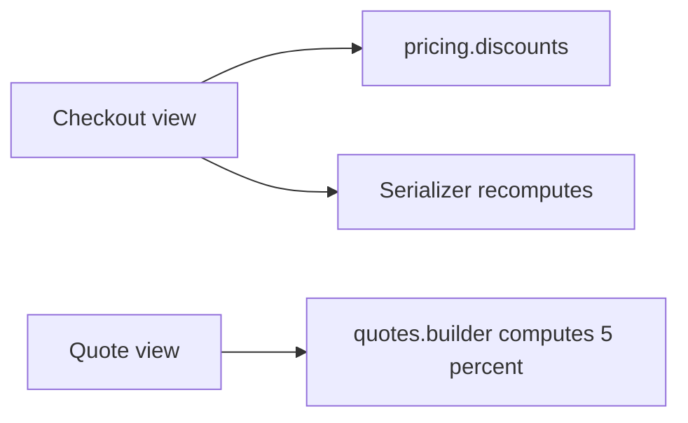

# Pricing: how it works today

**What it does:** Pricing turns a basket into a total for checkout and for quotes: it applies the loyalty discount, applies a coupon, and rounds to the currency (observed in the [baseline run](runs/baseline.md)).

**What differs from the stated design:** 2 of 4 stated dependencies differ and 1 of 2 stated rules is broken: the API layer decides the loyalty discount itself (source, pinned below; observed in the [probe](runs/probe_loyalty.py)).

**Recommended rework:** *Pricing owns discounts*: one function decides the loyalty discount, and both entry points call it. It is proposed because the rate changed 4 times in the fetched history and its three sites already disagree.

**Scope:** `shop/pricing/` and the serializers and views that call it; tax is excluded. **Inspected source:** commit `ddddddd` of the fictional `acme/shop`, no local changes. **What ran:** `python -m pytest tests/pricing -q`, 42 passed ([baseline run](runs/baseline.md)).

> **Fictional example.** This note demonstrates the rework-map template. Its shop, files, and runs are invented.

## Behavior to decide

| What happens | Evidence | Handoff |
| --- | --- | --- |
| A gold customer pays 36.00 at checkout and is quoted 38.00 for the same 40.00 basket. | [discounts.py:12](https://github.com/acme/shop/blob/dddddddddddddddddddddddddddddddddddddddd/shop/pricing/discounts.py#L12), [builder.py:27](https://github.com/acme/shop/blob/dddddddddddddddddddddddddddddddddddddddd/shop/quotes/builder.py#L27); we ran both ([probe](runs/probe_loyalty.py)) | fix-bug, once the user says which rate is right |

## Questions for the user

| Question | Why it matters | Default until answered | Answer |
| --- | --- | --- | --- |
| Which loyalty discount is right for gold customers, 10% or 5%? | The two sites disagree; the rework keeps one. | Keep both as they are; the rework is blocked on this rule. | "10%. The quote path was never updated." (2 June) |
| Is `apply_legacy_rounding` still needed for any currency? | It decides whether the function is removed. | It stays. | open |

## Capabilities

| Capability | Entry points | Decision sites | Evidence |
| --- | --- | --- | --- |
| [Loyalty discount](#loyalty-discount) | [views.py:31](https://github.com/acme/shop/blob/dddddddddddddddddddddddddddddddddddddddd/shop/api/views.py#L31), [views.py:58](https://github.com/acme/shop/blob/dddddddddddddddddddddddddddddddddddddddd/shop/api/views.py#L58) | 3, in `pricing`, `api`, and `quotes` | text, references, execution, history; [baseline run](runs/baseline.md) |
| Coupon | [views.py:31](https://github.com/acme/shop/blob/dddddddddddddddddddddddddddddddddddddddd/shop/api/views.py#L31) | not inspected: the user ranked it second | none taken |

### Loyalty discount

A gold or silver customer gets a percentage off the subtotal at checkout and in quotes; source at the pinned lines below, and both paths ran in the [probe](runs/probe_loyalty.py).

- [discounts.py:12](https://github.com/acme/shop/blob/dddddddddddddddddddddddddddddddddddddddd/shop/pricing/discounts.py#L12) decides the rate by tier: gold 10%, silver 5%. Found by text, references, and execution.
- [serializers.py:44](https://github.com/acme/shop/blob/dddddddddddddddddddddddddddddddddddddddd/shop/api/serializers.py#L44) recomputes the discount for display with its own `if tier == "gold"`. Found by execution and history only: it never names "discount".
- [builder.py:27](https://github.com/acme/shop/blob/dddddddddddddddddddddddddddddddddddddddd/shop/quotes/builder.py#L27) applies 5% to gold customers. Found by text and history.

The three sites disagree. For a gold customer with a 40.00 basket, checkout charges 36.00 and a quote shows 38.00; we ran both ([probe](runs/probe_loyalty.py)).

## Behavior no test protects

- The quote rate for gold customers: with [builder.py:27](https://github.com/acme/shop/blob/dddddddddddddddddddddddddddddddddddddddd/shop/quotes/builder.py#L27) changed from 5% to 50% in a scratch worktree, all 42 tests stayed green; we ran it ([baseline run](runs/baseline.md)).

The break of the checkout rate at `discounts.py:12` turned 3 tests red, so that behavior is pinned ([baseline run](runs/baseline.md)).

## Stated design and the code

The design is stated in the project's architecture page: "The API layer only translates requests; every price is decided in `pricing`" ([architecture.md](https://github.com/acme/shop/blob/dddddddddddddddddddddddddddddddddddddddd/docs/architecture.md#L18)).

| Relationship | Result | Evidence | What the user said |
| --- | --- | --- | --- |
| `api` to `pricing` | as stated | `import_edges.py`; [views.py:4](https://github.com/acme/shop/blob/dddddddddddddddddddddddddddddddddddddddd/shop/api/views.py#L4) | intended |
| `quotes` to `pricing` | not found | `import_edges.py` shows no edge; `builder.py` computes the discount itself at [builder.py:27](https://github.com/acme/shop/blob/dddddddddddddddddddddddddddddddddddddddd/shop/quotes/builder.py#L27) | drift |
| `api` to `storage` | not stated | [serializers.py:9](https://github.com/acme/shop/blob/dddddddddddddddddddddddddddddddddddddddd/shop/api/serializers.py#L9) imports the tier table | drift |
| `pricing` to `storage` | as stated | `import_edges.py`; [discounts.py:3](https://github.com/acme/shop/blob/dddddddddddddddddddddddddddddddddddddddd/shop/pricing/discounts.py#L3) | intended |

| Stated rule | Result | Evidence | What the user said |
| --- | --- | --- | --- |
| "The API layer only translates requests; every price is decided in `pricing`" ([architecture.md](https://github.com/acme/shop/blob/dddddddddddddddddddddddddddddddddddddddd/docs/architecture.md#L18)) | broken | [serializers.py:44](https://github.com/acme/shop/blob/dddddddddddddddddddddddddddddddddddddddd/shop/api/serializers.py#L44) computes the discount; [builder.py:27](https://github.com/acme/shop/blob/dddddddddddddddddddddddddddddddddddddddd/shop/quotes/builder.py#L27) does too | drift |
| "Totals are rounded to the currency once, in `pricing`" ([architecture.md](https://github.com/acme/shop/blob/dddddddddddddddddddddddddddddddddddddddd/docs/architecture.md#L21)) | holds | search for `quantize` and `round(` in `shop/`: one site, [rounding.py:3](https://github.com/acme/shop/blob/dddddddddddddddddddddddddddddddddddddddd/shop/pricing/rounding.py#L3) | intended |

## State and data

| State | Written by | Read by | Evidence |
| --- | --- | --- | --- |
| `customer.tier` | [accounts.py:70](https://github.com/acme/shop/blob/dddddddddddddddddddddddddddddddddddddddd/shop/accounts.py#L70) | the three decision sites above | search for `tier`, read at the lines; writers outside `shop/` not inspected |

| Data and key | Built or written at | Read at | Signs |
| --- | --- | --- | --- |
| the `order` dict, key `discount` | [views.py:36](https://github.com/acme/shop/blob/dddddddddddddddddddddddddddddddddddddddd/shop/api/views.py#L36), [serializers.py:44](https://github.com/acme/shop/blob/dddddddddddddddddddddddddddddddddddddddd/shop/api/serializers.py#L44) | [views.py:41](https://github.com/acme/shop/blob/dddddddddddddddddddddddddddddddddddddddd/shop/api/views.py#L41) with the default 0 | written in 2 files; read with a default; changed after it is handed over: with the dict frozen in `views.py`, 2 tests failed ([baseline run](runs/baseline.md)) |

## Structure today and proposed

The files by design part, the dependencies the code has, and where each rule is decided (source, at the pinned lines in the data; the loyalty paths ran in the [probe](runs/probe_loyalty.py)). The page draws it; switch to the proposal to see the rate move to `pricing`.

```structure-view
{
 "parts": [
  {
   "id": "api",
   "label": "API",
   "said": "only translates requests"
  },
  {
   "id": "quotes",
   "label": "Quotes",
   "said": "uses pricing"
  },
  {
   "id": "pricing",
   "label": "Pricing",
   "said": "every price is decided here"
  },
  {
   "id": "storage",
   "label": "Storage",
   "said": "customer records"
  }
 ],
 "files": [
  {
   "id": "views",
   "path": "shop/api/views.py",
   "part": "api"
  },
  {
   "id": "serializers",
   "path": "shop/api/serializers.py",
   "part": "api"
  },
  {
   "id": "builder",
   "path": "shop/quotes/builder.py",
   "part": "quotes"
  },
  {
   "id": "discounts",
   "path": "shop/pricing/discounts.py",
   "part": "pricing"
  },
  {
   "id": "rounding",
   "path": "shop/pricing/rounding.py",
   "part": "pricing"
  },
  {
   "id": "accounts",
   "path": "shop/accounts.py",
   "part": "storage"
  }
 ],
 "dependencies": [
  {
   "from": "views",
   "to": "discounts",
   "today": "as stated",
   "proposed": "as stated",
   "at": "shop/api/views.py:4",
   "why": "The design allows API to use pricing."
  },
  {
   "from": "views",
   "to": "builder",
   "today": "as stated",
   "proposed": "as stated",
   "at": "shop/api/views.py:5",
   "why": "The design allows API to use quotes."
  },
  {
   "from": "builder",
   "to": "discounts",
   "today": "not found",
   "proposed": "as stated",
   "at": "shop/quotes/builder.py:27",
   "why": "The design says quotes uses pricing; the builder computes the discount itself."
  },
  {
   "from": "serializers",
   "to": "accounts",
   "today": "not stated",
   "proposed": null,
   "at": "shop/api/serializers.py:9",
   "why": "Only pricing may read customer records."
  },
  {
   "from": "discounts",
   "to": "accounts",
   "today": "as stated",
   "proposed": "as stated",
   "at": "shop/pricing/discounts.py:3",
   "why": "Pricing reads the tier."
  }
 ],
 "rules": [
  {
   "name": "Loyalty discount rate",
   "owner": "discounts",
   "outcome": "moves",
   "note": "The quote rate waits for the decision on which rate is right.",
   "sites": [
    {
     "file": "discounts",
     "at": "shop/pricing/discounts.py:12",
     "what": "gold 10%, silver 5%"
    },
    {
     "file": "serializers",
     "at": "shop/api/serializers.py:44",
     "what": "recomputed for display"
    },
    {
     "file": "builder",
     "at": "shop/quotes/builder.py:27",
     "what": "gold 5%",
     "waits": true
    }
   ]
  },
  {
   "name": "A guest pays full price",
   "owner": "discounts",
   "outcome": "stays",
   "note": "Pinned by a test; fine.",
   "sites": [
    {
     "file": "discounts",
     "at": "shop/pricing/discounts.py:20",
     "what": "no tier, no discount"
    }
   ]
  }
 ],
 "data": [
  {
   "name": "The order dict",
   "proposed": "an Order value with declared fields, built once in views.py",
   "keys": [
    {
     "key": "discount",
     "writes": [
      {
       "file": "views",
       "at": "shop/api/views.py:36"
      },
      {
       "file": "serializers",
       "at": "shop/api/serializers.py:44"
      }
     ],
     "reads": [
      {
       "file": "views",
       "at": "shop/api/views.py:41",
       "default": "0"
      }
     ]
    }
   ]
  }
 ]
}
```

## Main flows

Checkout and quotes reach the discount by different paths (source; the [probe](runs/probe_loyalty.py) executed both paths end to end):



Source map:
- Checkout view — [views.py:31](https://github.com/acme/shop/blob/dddddddddddddddddddddddddddddddddddddddd/shop/api/views.py#L31).
- pricing.discounts — [discounts.py:12](https://github.com/acme/shop/blob/dddddddddddddddddddddddddddddddddddddddd/shop/pricing/discounts.py#L12).
- Serializer recomputes — [serializers.py:44](https://github.com/acme/shop/blob/dddddddddddddddddddddddddddddddddddddddd/shop/api/serializers.py#L44).
- Quote view — [views.py:58](https://github.com/acme/shop/blob/dddddddddddddddddddddddddddddddddddddddd/shop/api/views.py#L58).
- quotes.builder computes 5 percent — [builder.py:27](https://github.com/acme/shop/blob/dddddddddddddddddddddddddddddddddddddddd/shop/quotes/builder.py#L27).
- Checkout view to pricing.discounts — [views.py:36](https://github.com/acme/shop/blob/dddddddddddddddddddddddddddddddddddddddd/shop/api/views.py#L36).
- Checkout view to Serializer recomputes — [views.py:41](https://github.com/acme/shop/blob/dddddddddddddddddddddddddddddddddddddddd/shop/api/views.py#L41).
- Quote view to quotes.builder — [views.py:60](https://github.com/acme/shop/blob/dddddddddddddddddddddddddddddddddddddddd/shop/api/views.py#L60).

## Special cases

| Special case | Kind | Reach | Why it exists | Points to |
| --- | --- | --- | --- | --- |
| [discounts.py:20](https://github.com/acme/shop/blob/dddddddddddddddddddddddddddddddddddddddd/shop/pricing/discounts.py#L20) returns 0 when `tier` is missing | default | reached: guest checkout has no tier, `test_guest_pays_full_price` | commit "guest checkout", found with `git log -S` | real outcome: a guest has no discount |
| [rounding.py:8](https://github.com/acme/shop/blob/dddddddddddddddddddddddddddddddddddddddd/shop/pricing/rounding.py#L8) `apply_legacy_rounding` | compatibility path | unknown: no caller in the repository, removal probe left 42 tests green | no reason found in the fetched history | nothing found; asked the user |

2 further defaults in `shop/pricing/coupons.py` were counted and not inspected one by one.

## Findings

| Finding | Kind | Where | Cost today | Removed by |
| --- | --- | --- | --- | --- |
| [Loyalty discount decided in three places](#loyalty-discount-decided-in-three-places) | scattered rule | [discounts.py:12](https://github.com/acme/shop/blob/dddddddddddddddddddddddddddddddddddddddd/shop/pricing/discounts.py#L12), [serializers.py:44](https://github.com/acme/shop/blob/dddddddddddddddddddddddddddddddddddddddd/shop/api/serializers.py#L44), [builder.py:27](https://github.com/acme/shop/blob/dddddddddddddddddddddddddddddddddddddddd/shop/quotes/builder.py#L27) | 3 sites per change; the rate changed 4 times, from `git log -S` on the rate constants | [Pricing owns discounts](#pricing-owns-discounts) |
| [Legacy rounding has no caller](#legacy-rounding-has-no-caller) | unjustified special case | [rounding.py:8](https://github.com/acme/shop/blob/dddddddddddddddddddddddddddddddddddddddd/shop/pricing/rounding.py#L8) | no action: the file changed once | kept until the user answers |

### Loyalty discount decided in three places

One rule has three decision sites that do not agree, and nothing in the code ties them: `discounts.py` and `builder.py` changed together in 6 commits with no dependency between them, from `change_coupling.py --edges`. A person changing the rate must know all three; the quote path was missed once already, which the user confirmed.

```python url="https://github.com/acme/shop/blob/dddddddddddddddddddddddddddddddddddddddd/shop/quotes/builder.py#L26-L28"
def discount_for(customer, subtotal):
    if customer.tier == "gold":
        return subtotal * Decimal("0.05")
```

### Legacy rounding has no caller

`apply_legacy_rounding` has no caller in the repository and no test fails without it; we ran the removal probe ([baseline run](runs/baseline.md)). Its reach is unknown, because a caller outside the repository is not excluded.

## Looks wrong, is fine

- [discounts.py:20](https://github.com/acme/shop/blob/dddddddddddddddddddddddddddddddddddddddd/shop/pricing/discounts.py#L20) returns 0 for a missing tier. It is the guest-checkout rule, documented in its commit and pinned by a test.

## Targets

**Recommendation:** *Pricing owns discounts*, proposed because the rule changes often and its sites already disagree. **Chosen:** *Pricing owns discounts* (the user, 2 June).

### Pricing owns discounts

**Owners:** proposed: `shop/pricing/discounts.py` decides the loyalty rate; `api` and `quotes` call it.

**Interface:** proposed: `loyalty_discount(tier, subtotal) -> Decimal`, the function that exists today at [discounts.py:12](https://github.com/acme/shop/blob/dddddddddddddddddddddddddddddddddddddddd/shop/pricing/discounts.py#L12).

**Guarantees at the boundary:** proposed: none new; the guest default stays where it is.

**Failure behavior:** proposed: unchanged. No fallback is in scope.

**Cost and risk:** proposed: 3 files, 2 call sites, 1 pin to write for quotes.

**Measure:** decision sites for the loyalty rate go from 3 to 2 with these steps, and to 1 once the quote rate is decided; the broken rule then holds (proposed).

### Leave it as it is

Each rate change keeps touching three files, 4 times in the fetched history, and the two totals stay different until someone notices again (inferred from the history and the probe). Still worth doing under this choice: the pin for the quote rate.

A shared rate table that the three sites read is the smaller alternative (proposed). It removes the disagreement and leaves three places that apply the rate, so it is not recommended.

## Lock tests

| Lock test | Behavior it locks | Failed under | Suite |
| --- | --- | --- | --- |
| `test_gold_quote_records_38` in `tests/quotes/test_lock.py` | a gold quote for a 40.00 basket is 38.00; records a value under decision | quote rate changed to 50% at [builder.py:27](https://github.com/acme/shop/blob/dddddddddddddddddddddddddddddddddddddddd/shop/quotes/builder.py#L27): failed, we ran it ([baseline run](runs/baseline.md)) | 43 passed ([baseline run](runs/baseline.md)) |
| `test_checkout_discount_shown` in `tests/api/test_lock.py` | the order JSON shows a 4.00 discount for a gold 40.00 basket | display rate changed at [serializers.py:44](https://github.com/acme/shop/blob/dddddddddddddddddddddddddddddddddddddddd/shop/api/serializers.py#L44): failed, we ran it ([baseline run](runs/baseline.md)) | 43 passed ([baseline run](runs/baseline.md)) |

## Rework steps

1. Pin, proposed, structural: add a characterization test for the quote total of a gold customer in `tests/quotes/`, from the [probe](runs/probe_loyalty.py); see it fail once with the rate changed by hand.
2. Gather, proposed, structural: make `serializers.py` call `loyalty_discount` in place of its own condition; 1 call site; proof is the pins green and the same checkout total, 36.00.
3. Lock in, proposed, structural: add `quotes` to `pricing` to the stated design file and run `design_conformance.py` in the project's checks.

Waiting for a decision, not a rework step: moving `builder.py` to `loyalty_discount` changes the quote total from 38.00 to 36.00. It is listed under [behavior to decide](#behavior-to-decide) and proposed for fix-bug.

## Limits and open questions

The coupon capability was not inspected. Edges come from static imports only. The history holds 220 commits. Callers of `apply_legacy_rounding` outside the repository are unknown.

## Evidence and record

The baseline, the probe outputs, and the script commands are in the [baseline run](runs/baseline.md) and [probe](runs/probe_loyalty.py).

## Status and label key

These labels describe separate judgments. Read each against its stated scope and evidence; no label alone establishes overall readiness or approval.

### Key: Stated dependencies against the code

| Option | Meaning |
| --- | --- |
| as stated | The design allows the relationship and the extracted dependencies show it. The result is as complete as the dependency source named beside it. |
| not stated | The code has the relationship and the stated design does not allow it. It is drift or an intended relationship the design never recorded; the user's answer says which. |
| not found | The design names the relationship and no extracted dependency shows it. The dependency may run through something the source of the edges cannot see. |

### Key: Stated rules against the code

| Option | Meaning |
| --- | --- |
| holds | The search or run named beside the rule found nothing that breaks it. It holds as far as that check reaches. |
| broken | A pinned line or a run shows the code doing what the stated rule excludes. It is drift, or the rule is out of date; the user's answer says which. |
| not checked | The rule was recorded and not compared with the code. |

### Key: Special-case reach

| Option | Meaning |
| --- | --- |
| reached | A named caller, input, test, or run reaches the special case. |
| not reached | The callers were enumerated and none produces the state, and a probe through the public boundary did not reach the case. Other inputs remain possible. |
| unknown | Nothing establishes whether the case is reached. Missing test coverage alone gives this status; the case stays. |

### Key: Structure findings

| Option | Meaning |
| --- | --- |
| scattered rule | One rule is decided at more than one place, and nothing in the code says the places must change together. |
| misplaced logic | A decision is made away from the module that owns the state or rule it decides. |
| needless link | Pieces that change for different reasons are tied together. |
| surplus | Code with no reason of its own to exist, such as a wrapper that only delegates, an option nothing varies, or code nothing reaches. |
| shared mutable state | State that more than one module writes, or data a module changes after another module handed it over. What a value holds depends on every writer and the order they ran in. |
| shapeless data | Data passed between modules with no declared shape, such as a hash or dict, so each site that reads or writes a key decides part of it. |
| unjustified special case | Code for one situation with no caller, input, test, incident, or decision behind it. It stays until its removal has the evidence the map names. |

### Key: Diagram evidence

| Option | Meaning |
| --- | --- |
| observed | An identified current or recorded run produced the behavior shown. Retain its source snapshot, conditions, and evidence limits. |
| source | The diagram traces inspected source at its mapped lines. It does not claim runtime execution. |
| proposed | The diagram shows candidate behavior not established as implemented. Proposed elements map to decisions, requirements, or proposals; existing behavior still maps to source lines. Agreement is stated separately. |
